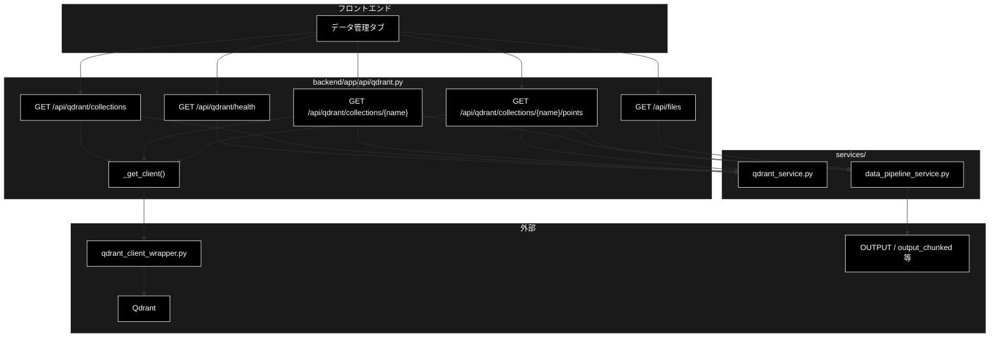

# api/qdrant.py - Qdrant 参照 API ドキュメント

**Version 1.7** | 最終更新: 2026-10-14

> **本書の位置づけ**: `backend/app/api/qdrant.py`（Qdrant 参照系（読み取り専用）と入力ファイル一覧）の **IPO リファレンス**。
> 引くための文書であり、**設計の「なぜ」と処理の流れは上位の文書が正本**である。
>
> | 知りたいこと | 参照先 |
> |---|---|
> | エンドポイント一覧とステータス方針 | [`README_backend_api.md` §4.0・§4.3](README_backend_api.md) |
> | コレクションの作り方 | [`data_jobs.md`](../../core/docs/data_jobs.md) |
> | 文書全体の地図 | [`README_backend_app.md`](../../docs/README_backend_app.md) |

> **参考ドキュメント**
> - [`backend/app/api/docs/data.md`](./data.md) — 登録・削除（副作用のある系）のジョブ API
> - [`data_jobs.md`](../../core/docs/data_jobs.md) — データ準備パイプライン全体の設計

---

## 目次

- [概要](#概要)
- [1. アーキテクチャ構成図](#1-アーキテクチャ構成図)
- [2. エンドポイント一覧](#2-エンドポイント一覧)
- [3. 関数 IPO 詳細](#3-関数-ipo-詳細)
  - [使用例](#31-使用例)
- [4. Qdrant 未起動時の扱い](#4-qdrant-未起動時の扱い)
- [5. 使用例](#5-使用例)
- [6. 変更履歴](#6-変更履歴)

---

## 概要

`backend/app/api/qdrant.py` は、Qdrant コレクションの**参照 API（読み取り専用）**である。

チャンキング → Q/A 生成 → Qdrant 登録 というデータ準備パイプラインのうち、
**副作用のない参照系**だけをここに置く。登録・削除はジョブ基盤（`core/jobs.py`）と
HITL CONFIRM を経由するため、別ルータ（[`api/data.py`](./data.md)）になる。

実処理は `services/qdrant_service.py` が持つ。本モジュールは
`services/data_pipeline_service.py` を挟んで **JSON 化するだけの薄い層**である。

### 主な責務

- Qdrant の稼働確認（**落ちていても 200 を返す**）
- コレクション一覧・詳細・ポイントのプレビュー
- 入力ファイル候補の列挙（チャンキング・登録の入力選択用）

### 各責務対応のモジュール

| # | 責務 | 対応モジュール | 説明 |
|---|------|--------------|------|
| 1 | Qdrant の稼働確認（落ちていても 200） | `services/qdrant_service.py::QdrantHealthChecker` | `GET /api/qdrant/health`。接続失敗は例外にせず `QdrantHealth` の中身で返す |
| 2 | コレクション一覧・詳細・ポイントのプレビュー | `services/qdrant_service.py::get_all_collections` / `QdrantDataFetcher` | クライアントは `qdrant_client_wrapper.py::get_qdrant_client`（`_get_client()` 経由）。ポイントの DataFrame は `services/data_pipeline_service.py::dataframe_to_records` / `collection_columns` で JSON へ整形 |
| 3 | 入力ファイル候補の列挙 | `services/data_pipeline_service.py::list_input_files` / `ALLOWED_INPUT_DIRS` | `GET /api/files?dir=`。許可ディレクトリ外は 400（`PathNotAllowedError`） |

### 主要機能一覧

| 機能 | 説明 |
|------|------|
| `_get_client()` | Qdrant クライアントを取得。接続不可なら **503** |
| `qdrant_health()` | 稼働確認。**落ちていても 200**（本文の `available` で判定） |
| `list_collections()` | コレクション一覧（名前・件数・ステータス） |
| `get_collection(name)` | 詳細（ベクトル設定＋データ元の集計） |
| `get_collection_points(name, limit)` | ポイントのプレビュー |
| `list_files(dir)` | 入力ファイル候補の列挙（許可ディレクトリ内のみ） |

---

## 1. アーキテクチャ構成図



---

## 2. エンドポイント一覧

| メソッド | パス | レスポンス | Qdrant 停止時 |
|---|---|---|---|
| GET | `/api/qdrant/health` | `QdrantHealth` | **200**（`available: false`） |
| GET | `/api/qdrant/collections` | `List[CollectionInfo]` | 503 |
| GET | `/api/qdrant/collections/{name}` | `CollectionDetail` | 503 |
| GET | `/api/qdrant/collections/{name}/points` | `CollectionPoints` | 503 |
| GET | `/api/files` | `InputFileListResponse` | 200（Qdrant 不要） |

---

## 3. 関数 IPO 詳細

### 3.1 使用例

| # | パターン | いつ使うか | 例 |
|---|---------|-----------|----|
| 1 | **基本**: 疎通 → コレクション一覧（起動時・未起動時） | 画面のデータ管理タブを開いたときと同じ順 | 3.1.1 |
| 2 | 1 コレクションの詳細とポイントのプレビュー | 登録した中身を確かめる | 3.1.2 |

> 📝 **確かめ方（2026-10-11）**: どちらも `PYTHONPATH=. python3 <例>.py` で実行した。3.1.1 は VM の Qdrant（`docker compose`）を起動した状態と、
> `docker stop` で止めた状態の 2 回。3.1.2 は 4 次元の一時コレクションを作って実行し、最後に消した。

#### 3.1.1 基本: 疎通 → コレクション一覧

本モジュールは**読み取り専用**。Qdrant が落ちていても 500 にせず、「使えない」ことを返す（画面を白くしないため）。

```python
from fastapi.testclient import TestClient
from backend.app.main import app

c = TestClient(app)

# 1. まず疎通を見る（未起動でも 200 で available=False が返る）
h = c.get("/api/qdrant/health")
print(h.status_code, h.json()["available"], h.json()["message"], h.json()["collections_count"])

# 2. コレクション一覧（未起動なら空配列。例外を投げない）
r = c.get("/api/qdrant/collections")
print(r.status_code, [x["name"] for x in r.json()][:2])

# 実行結果（Qdrant を起動した状態。コレクションは VM にあった 5 個）:
# 200 True Connected 5
# 200 ['document_chunks_test', 'document_qa']
#
# 実行結果（docker stop で止めた状態）:
# 200 False Connection refused (port closed) None
# 200 []
```

> ⚠️ **未起動と「コレクションが 0 件」は一覧だけでは区別できない。** 先に `/api/qdrant/health` を見ること。
> 画面もこの順で呼び、`available=False` ならバナーを出す。

#### 3.1.2 コレクションの中身をのぞく

```python
from fastapi.testclient import TestClient
from qdrant_client import QdrantClient
from qdrant_client.models import Distance, PointStruct, VectorParams

from backend.app.main import app

# 例のための一時コレクション（4 次元・2 件。本物は 3072 次元）
q = QdrantClient(url="http://localhost:6333")
q.create_collection("qdrantdoc_demo", vectors_config=VectorParams(size=4, distance=Distance.COSINE))
q.upsert("qdrantdoc_demo", points=[
    PointStruct(id=1, vector=[1, 0, 0, 0], payload={"question": "送料はいくら？", "answer": "全国一律600円"}),
    PointStruct(id=2, vector=[0, 1, 0, 0], payload={"question": "返品できる？", "answer": "到着後14日以内"}),
])

c = TestClient(app)
# 1. 詳細（件数・次元・距離）
print(c.get("/api/qdrant/collections/qdrantdoc_demo").json())
# 2. ポイントのプレビュー（payload を表にした形。limit は 1〜500）
pts = c.get("/api/qdrant/collections/qdrantdoc_demo/points", params={"limit": 5}).json()
print({k: v for k, v in pts.items() if k != "rows"}, pts["rows"][0])
# 3. 存在しないコレクションは 404、limit の範囲外は 422
print(c.get("/api/qdrant/collections/nope").status_code,
      c.get("/api/qdrant/collections/qdrantdoc_demo/points", params={"limit": 0}).status_code)

q.delete_collection("qdrantdoc_demo")

# 実行結果:
# {'name': 'qdrantdoc_demo', 'points_count': 2, 'vectors_count': 2, 'indexed_vectors': 0, 'status': 'green', 'vector_size': 4, 'distance': 'Cosine', 'sources': {'unknown': {'sample_count': 2, 'method': 'unknown', 'domain': 'unknown', 'estimated_total': 2, 'percentage': 100.0}}, 'sample_size': 2, 'error': None}
# {'name': 'qdrantdoc_demo', 'columns': ['ID', 'question', 'answer'], 'limit': 5} {'ID': 1, 'question': '送料はいくら？', 'answer': '全国一律600円'}
# 404 422
```

> 📌 `sources` は先頭からのサンプル（`sample_size` 件）を payload の `source` で数えた内訳（`generation_method` / `domain` も添える）。項目が無ければ `unknown` にまとまる。
> プレビューの `columns` は payload のキーを `ID` の後ろに並べたもの（画面の表の見出し）。

### 3.2 `_get_client`

```python
def _get_client()
```

| 項目 | 内容 |
|------|------|
| **Input** | なし |
| **Process** | `qdrant_client_wrapper.get_qdrant_client()` を呼び、例外を捕まえて `HTTPException(503)` に変換する |
| **Output** | Qdrant クライアント |

> ⚠️ **`get_qdrant_client()` はシングルトンを返すが、生成時点では接続確認をしない。**
> 実際にリクエストを送るまで失敗が分からないため、呼び出し側で例外を捕まえて 503 に変換している。
> 503 の本文には起動コマンド（`docker compose -f docker-compose/docker-compose.yml up -d`）を載せる。

### 3.3 `qdrant_health`

```python
@router.get("/qdrant/health", response_model=QdrantHealth)
def qdrant_health() -> QdrantHealth
```

| 項目 | 内容 |
|------|------|
| **Input** | なし |
| **Process** | `QdrantHealthChecker().check_qdrant()` を呼ぶ。例外なら `available=False` ＋ 理由を本文へ。`info` からコレクション数を拾う（`collections` がリストならその長さ、`collections_count` が int ならそれ） |
| **Output** | `QdrantHealth(available, message, url, collections_count)` — **常に 200** |

> ⚠️ **Qdrant が落ちていても 200 を返す。**
> 503 にすると画面側で「エラーバナー」と「Qdrant を起動してください」という案内を
> **出し分けられない**ため。稼働の有無は本文の `available` で判定させる。

### 3.4 `list_collections`

```python
@router.get("/qdrant/collections", response_model=List[CollectionInfo])
def list_collections() -> List[CollectionInfo]
```

| 項目 | 内容 |
|------|------|
| **Input** | なし |
| **Process** | `_get_client()` → `get_all_collections(client)`。例外は **503** |
| **Output** | `List[CollectionInfo]`（`name` / `points_count` / `status`） |

### 3.5 `get_collection`

```python
@router.get("/qdrant/collections/{name}", response_model=CollectionDetail)
def get_collection(name: str) -> CollectionDetail
```

| 項目 | 内容 |
|------|------|
| **Input** | `name` |
| **Process** | `collection_exists()` で存在確認（無ければ **404**）。`QdrantDataFetcher.fetch_collection_info()` と `fetch_collection_source_info()` を呼び、`config` からベクトル設定を取り出す |
| **Output** | `CollectionDetail`（件数・ベクトル数・インデックス済み数・status・`vector_size` / `distance`・`sources` / `sample_size`・`error`） |

> 📝 **`fetch_*` は例外を投げず `{"error": ...}` を返す実装。**
> そのまま拾って `CollectionDetail.error` に載せる。`fetch_collection_info` が
> エラーを返した時点で早期 return し、`sources` は取りに行かない。

### 3.6 `get_collection_points`

```python
@router.get("/qdrant/collections/{name}/points", response_model=CollectionPoints)
def get_collection_points(name: str, limit: int = Query(default=50, ge=1, le=500)) -> CollectionPoints
```

| 項目 | 内容 |
|------|------|
| **Input** | `name`、`limit`（1–500・既定 50） |
| **Process** | 存在確認（無ければ 404）→ `fetch_collection_points(name, limit)` → `dataframe_to_records()` で dict 化 → `collection_columns(rows)` で列名を決める |
| **Output** | `CollectionPoints(name, columns, rows, limit)` |

> 📝 **`columns` を別に返すのは payload のキーがコレクションごとに違うから。**
> 画面はこの順で列を並べる。長い文字列は `fetch_collection_points` 側で
> **200 文字に切り詰められている。**

### 3.7 `list_files`

```python
@router.get("/files", response_model=InputFileListResponse)
def list_files(dir: str = Query(default="OUTPUT")) -> InputFileListResponse
```

| 項目 | 内容 |
|------|------|
| **Input** | `dir`（許可ディレクトリ名・既定 `"OUTPUT"`） |
| **Process** | `list_input_files(dir)`。`PathNotAllowedError` なら **400** |
| **Output** | `InputFileListResponse(dir, allowed_dirs, files)` |

> ⚠️ **許可ディレクトリのホワイトリスト外を指定すると 400。**
> 絶対パスは返さず **`ディレクトリ名/ファイル名` 形式に限定**する
> （そのままチャンキング・登録の `input_file` に渡せる形）。

---

## 4. Qdrant 未起動時の扱い

| エンドポイント | 挙動 | 理由 |
|---|---|---|
| `/api/qdrant/health` | **200** ＋ `available: false` ＋ 理由 | 画面でエラーバナーと起動案内を出し分けるため |
| 一覧・詳細・ポイント | **503** ＋ 起動コマンド入りの本文 | Qdrant が要るので素直に失敗させる |
| `/api/files` | 200（Qdrant 不要） | ファイルシステムだけを見る |

---

## 5. 使用例

```bash
# 稼働確認（落ちていても 200）
curl http://localhost:8000/api/qdrant/health
# {"available": true, "message": "...", "url": "http://localhost:6333", "collections_count": 7}

# 一覧
curl http://localhost:8000/api/qdrant/collections

# 詳細
curl http://localhost:8000/api/qdrant/collections/gov_faq_anthropic

# ポイントのプレビュー（既定 50 件・最大 500）
curl 'http://localhost:8000/api/qdrant/collections/gov_faq_anthropic/points?limit=10'

# 入力ファイル候補
curl 'http://localhost:8000/api/files?dir=OUTPUT'
```

---

## 6. 変更履歴

| バージョン | 日付 | 変更内容 |
|---|---|---|
| 1.0 | — | 初版作成。`backend/app/api/qdrant.py`（200 行）の 6 関数を IPO 形式で記述。「health だけ 200 を返す」設計理由、`get_qdrant_client()` が生成時に接続確認をしないため 503 変換が要ること、`fetch_*` が例外ではなく `{"error": ...}` を返すこと、`columns` を別に返す理由、許可ディレクトリのホワイトリストを実コードのコメントから起こして記載 |
| 1.1 | 2026-09-15 | **§3.1「使用例」を新設**（2026-09-15）。ドキュメント規約 `a_class_method_md_format.md` §6.1 が IPO 詳細セクションの冒頭に必須としている代表ワークフローが欠落していた。疎通確認 → コレクション一覧（未起動でも 200 が返ること）、コレクションの中身をのぞく 2 本を追加し、**実行して出力を確認した**（外部依存が要る例はその旨を明記）。旧 §3.1〜§3.6 は §3.2〜§3.7 へ繰り下げ |
| 1.2 | 2026-09-16 | 3 階建て再編（`reference/` へ移設）に伴い、冒頭へ**位置づけと上位文書への導線**を追加した |
| 1.3 | 2026-10-10 | 概要の「各責務対応のモジュール」を「主な責務」（3 項目）と 1:1 に揃えた（「整形」「クライアント生成」は責務 2 の説明へ移し、説明列を足した）。変更履歴を 3 列へ移した |
| 1.4 | 2026-10-11 | `backend/docs/reference/api_qdrant.md` から移した（`a_cross_doc_md_format.md` §1.1.2。リンクを付け替えた）。§3.1 を作り直した。3.1.1 は Qdrant の起動時と停止時（`docker stop`）の両方で、3.1.2 は一時コレクションで詳細とプレビューを実行して確かめた |
| 1.5 | 2026-10-12 | backend/docs/ の横断文書の廃止（2026-10-12）に追随し、参照先を backend/app/docs/README_app.md・backend/app/api/docs/README_api.md・backend/app/core/docs/core_process_flow.md などへ付け替えた |
| 1.6 | 2026-10-14 | 索引の改名（frontend/docs/README.md → README_frontend.md、README_api.md → README_backend_api.md、README_core.md → README_backend_core.md）に合わせて参照を付け替えた |
| 1.7 | 2026-10-14 | 索引の改名（backend/app/docs/README_app.md → README_backend_app.md）に合わせて参照を付け替えた |
