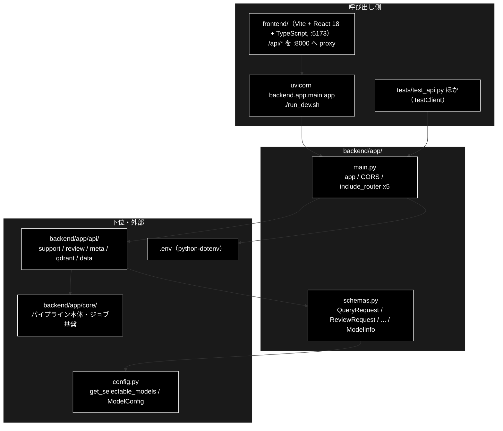
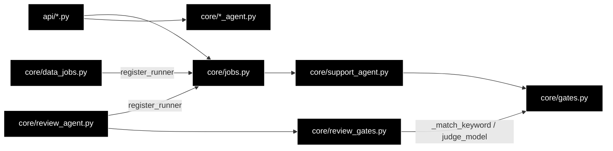

# README_app.md - backend/app/ ディレクトリ概要

**Version 1.2** | 最終更新: 2026-10-14

`backend/app/` の入口となる文書。FastAPI の起動口（`main.py`）と、API の入出力の型（`schemas.py`）を置く。
ルーター（`api/`）とパイプライン本体・ジョブ基盤（`core/`）は**別のディレクトリ**で、それぞれの `docs/` に README がある。
各モジュールの引数・戻り値は各モジュールの文書（IPO）に置き、ここには書かない。

> ⚠️ **本リポジトリは Anthropic 版。** LLM は `ANTHROPIC_API_KEY`、Embedding は Gemini（`GOOGLE_API_KEY`）。
> 姉妹リポジトリ `grace_v2_local`（Ollama 版）の同名ファイルとは中身が違うので、文書をコピーで持ち込まない（CLAUDE.md §5）。

---

## 目次

- [概要](#概要)
  - [主な責務](#主な責務)
  - [各責務対応のモジュール](#各責務対応のモジュール)
  - [アーキテクチャ構成図](#アーキテクチャ構成図)
- [1. モジュール一覧（索引）](#1-モジュール一覧索引)
- [2. 使い方（代表的なワークフロー）](#2-使い方代表的なワークフロー)
- [3. 公開 API（__init__.py）](#3-公開-api__init__py)
- [4. 処理フロー・データフロー](#4-処理フローデータフロー)
- [5. 既知の制約・残課題](#5-既知の制約残課題)
- [6. 変更履歴](#6-変更履歴)

---

## 概要

`backend/app/` は GRACE の Web API（FastAPI・`:8000`）の**最上位**である。`main.py` が 5 つのルーター（`api/`）を 1 つの `app` にまとめ、
`schemas.py` がリクエストの検証とレスポンスの形を決める。エージェントを動かす入口はこの Web API だけである（CLI は無い。CLAUDE.md §1）。

### 主な責務

- FastAPI アプリを組み立てる（`.env` の読み込み・CORS・5 つのルーターの登録）
- API の入出力の型を定め、リクエストを検証する（`frontend/src/types.ts` と 1:1）

### 各責務対応のモジュール

| # | 責務 | 対応モジュール | 説明 |
|---|------|--------------|------|
| 1 | アプリの組み立て | `main.py` | `app = FastAPI(...)`。CORS は Vite の dev サーバ（`:5173`）だけを許可。認証は無い（ローカル開発専用） |
| 2 | 入出力の型と検証 | `schemas.py` | Pydantic モデル。`model` は `config.py::get_selectable_models()` の選択肢だけを受け付ける。不正な入力は 422 |

### アーキテクチャ構成図



**データフロー（要点）**: ブラウザの JSON → `schemas.py` のリクエストモデルで検証（不正なら 422）→ `api/` がジョブを起動 →
`core/` の runner が結果の dict を返す → `schemas.py` の応答モデルで検証して返す（知らないキーは落ち、足りないキーは既定値）。詳細は §4。

---

## 1. モジュール一覧（索引）

| モジュール | 文書 | 種別 | 行数 | Ver | 概要 |
|---|---|---|---:|---|---|
| `main.py`（66 行） | [`main.md`](main.md) | E | 504 | 1.9 | FastAPI アプリ。`.env`・CORS・5 ルーター（25 エンドポイント） |
| `schemas.py`（568 行） | [`schemas.md`](schemas.md) | E | 1189 | 1.16 | API の入出力の型（Pydantic）。`frontend/src/types.ts` と対で保つ |

> 行数は文書の行数（実測）。`__init__.py` は空（§3）。Support / Review の 1 周の流れは `core/docs/core_process_flow.md`、backend 全体の構造は本書 §4 にある。

**関連する README**: [`api/docs/README_backend_api.md`](../api/docs/README_backend_api.md)（ルーター）/ [`core/docs/README_backend_core.md`](../core/docs/README_backend_core.md)（パイプライン・ジョブ基盤）/
本書 §4（backend 全体の地図・目的別の早見表）。

---

## 2. 使い方（代表的なワークフロー）

> 📝 **確かめ方（2026-10-11）**: §2.1 は VM で uvicorn を起動して `curl` した（API キーを入れていない環境）。

| やりたいこと | 入口 | 使用例 |
|---|---|---|
| 開発サーバを起動する（backend + frontend） | `./run_dev.sh` | 直下 [`README.md`](../../../README.md) §7 |
| API だけを起動して確かめる | `uvicorn backend.app.main:app` | §2.1・[`main.md`](main.md) §4.1 |
| サーバを立てずに API を叩く（テスト） | `fastapi.testclient.TestClient(app)` | [`main.md`](main.md) §4.1.2 |
| リクエストの形・422 になる入力を確かめる | `schemas.QueryRequest` ほか | [`schemas.md`](schemas.md) §4.1 |

### 2.1 API だけを起動して確かめる

```bash
docker compose -f docker-compose/docker-compose.yml up -d     # Qdrant（/api/health には不要）
uvicorn backend.app.main:app --reload --port 8000              # 別ターミナル
curl -s localhost:8000/api/health
curl -s localhost:8000/openapi.json | python3 -c "import json,sys; print(len(json.load(sys.stdin)['paths']))"

# 出力例:
# {"status":"ok","anthropic_api_key":false,"google_api_key":false}
# 25
```

> 📌 `anthropic_api_key` / `google_api_key` は環境変数にキーがあるかだけを示す（値は返さない）。`false` でも起動はでき、メタ情報（`/api/verticals` 等）は返る。
> エージェントの実行（`POST /api/support/query` 等）はジョブとして受け付けられ、キーが無いと `error` イベントで失敗する（[`api/docs/README_backend_api.md`](../api/docs/README_backend_api.md) §2）。

---

## 3. 公開 API（__init__.py）

公開 API なし（`backend/app/__init__.py` は空）。`from backend.app.main import app` / `from backend.app.schemas import QueryRequest` のようにモジュールを直接 import する。

---

## 4. 処理フロー・データフロー

backend の文書は `backend/app/docs/`（本書）・`backend/app/api/docs/`・`backend/app/core/docs/` の 3 か所だけにある
（2026-10-12 に `backend/docs/` を廃止した）。

| 知りたいこと | 文書 |
|---|---|
| backend の層構造・依存の向き・backend が持たないもの | 本書 §4.1・§4.2 |
| モデル名の解決（既定・UI からの上書き・世代ごとの送り方）・API キー | 本書 §4.3 |
| 全エンドポイント・SSE のワイヤ形式・HITL の往復・HTTP ステータス・`types.ts` との対応 | [`api/docs/README_backend_api.md`](../api/docs/README_backend_api.md) §4 |
| GRACE-Support / GRACE-Review の 1 周・設計判断・ジョブ基盤の流れ | [`core/docs/core_process_flow.md`](../core/docs/core_process_flow.md) |
| 各モジュールの引数・戻り値 | 各ディレクトリの README の索引（§1・`README_backend_api.md` §1・`README_backend_core.md` §1） |

**目的別の早見表**

| やりたいこと | 読む文書 |
|---|---|
| 新しいエンドポイントを足す | `README_backend_api.md` §4 → `core_process_flow.md` §3（runner 注入） |
| 新しいジョブ種別を足す | `core_process_flow.md` §3 → `README_backend_core.md` §5.2（チェックリスト）→ `core/docs/data_jobs.md` |
| 回答が escalate に倒れる理由を追う | `core_process_flow.md` §1 → `core/docs/gates.md` |
| 指摘が出ない・誤検知する理由を追う | `core_process_flow.md` §2 → `core/docs/review_gates.md` |
| 業界プロファイル / ルールを増やす | `core/docs/verticals.md` / `core/docs/rulesets.md`（どちらも「増やすときの手順」） |
| 規程コレクション（`ec_ad_rules_anthropic`）を作り直す | `core/docs/rulesets.md`（規程コレクションの準備） |
| 既定モデルを変える | 本書 §4.3.5・CLAUDE.md §3.1 |
| 触る前に落とし穴を確認する | `README_backend_core.md` §5.2・CLAUDE.md |

| データ | 形式 | 作る側 | 使う側 |
|---|---|---|---|
| リクエスト | `QueryRequest` / `ReviewRequest` / `ChunkingRequest` / `QaGenerationRequest` / `RegisterRequest` / `DeleteCollectionsRequest` / `ConfirmRequest` | 画面（`frontend/src/api/client.ts`） | `api/` のルーター |
| 受付 | `QueryAccepted`（`job_id` / `stream_url`） | `api/` | 画面（SSE を購読する） |
| 結果 | `JobStatusResponse` / `ReviewJobStatusResponse` / `DataJobStatusResponse` | `api/`（runner の dict を検証） | 画面 |
| メタ情報 | `ModelChoice` / `ModelInfo` / `VerticalInfo` / `RuleSetInfo` | `api/meta.py` | 画面のセレクタ・ヘッダー |

### 4.1 依存の向き

守られている規律は 3 つ。**ここを崩すと循環 import になる。**

1. **`core/` は `api/` を知らない。** 逆向きの import は存在しない。
2. **`jobs.py` は Review・データ準備を知らない。** Support の runner だけを自分で登録し、Review / データ準備の runner は
   `review_agent.py` / `data_jobs.py` が**自分の import 時に** `register_runner()` で登録する（[`core_process_flow.md`](../core/docs/core_process_flow.md) §3）。
3. **判定ロジックは `*_gates.py` に集める。** `review_gates.py` は `gates.py` から `_match_keyword` / `judge_model` を再利用する（Review → Support の一方向）。



### 4.2 backend が持たないもの（外部境界）

`backend/app/` が import している**リポジトリ内の外部モジュール**は次がすべてである（標準ライブラリ・FastAPI・Pydantic を除く）。
**この表の裏返しが「backend を読むだけでは分からないこと」**で、RAG 検索・planner のプロンプト・Qdrant への upsert などは
`grace/docs/`・`services/docs/`・`chunking/docs/`・`qa_qdrant/docs/` 側の文書にある。

| 外部モジュール | 使う側 | 何を委ねているか |
|---|---|---|
| `grace`（`create_intervention_handler` / `create_tool_registry` / `get_config`） | `support_agent.py` / `review_agent.py` | エージェント基盤の生成・設定解決 |
| `grace.confidence.create_groundedness_verifier` | `support_agent.py` / `review_agent.py` | ③④ 根拠検証（**Support / Review 共用**） |
| `grace.intervention`（`InterventionRequest` / `InterventionResponse` / `InterventionAction`） | `intervention_bridge.py` | HITL の型とアクション |
| `grace.llm_compat.create_chat_client` | `gates.py` / `review_gates.py` | 判定系の LLM 呼び出し |
| `support_actions`（`create_action_backend` / `create_identity_verifier`） | `support_agent.py` / `review_agent.py` | ⑥⑦ アクション実行・本人確認（**共用**） |
| `services.qdrant_service` / `services.data_pipeline_service` | `api/qdrant.py` / `data_jobs.py` | Qdrant の参照・入力ファイル解決・コレクション操作 |
| `chunking.csv_text_to_chunks_text_csv` / `chunking.async_api_client` | `data_jobs.py` | チャンク化本体 |
| `qa_qdrant.register_to_qdrant` | `data_jobs.py` | Qdrant 登録本体 |
| `qdrant_client_wrapper.get_qdrant_client` | `api/qdrant.py` | Qdrant クライアント生成 |
| `config.ModelConfig` / `config.get_selectable_models` | `schemas.py` / `api/meta.py` / `data_jobs.py` / `review_gates.py` / `support_agent.py` / `review_agent.py` | モデルの選択肢・既定値・単価 |

> ⚠️ **共用部品は Support と Review の両方に効く。** `GroundednessVerifier` / `InterventionBridge` / `support_actions.py` を
> 触った変更は、Support のつもりでも Review を壊す。共用部品を触ったら `tests/test_review_*.py` も流す。

### 4.3 モデル名の解決と API キー

プロバイダの方針（LLM は Anthropic・Embedding は Gemini）と 5 本の解決経路の一覧は CLAUDE.md §3・§3.1 が正。ここには backend 側の仕組みを書く。

#### 4.3.1 判定系と ③ Detect は解決関数を通す

```python
# backend/app/core/gates.py — 軽量モデル（意図分類・情報なし判定・言及分類・空疎判定）
def judge_model(config) -> str:   # config.llm.light_model → 無ければ verticals.INTENT_MODEL

# backend/app/core/review_gates.py — 本モデル（③ Detect の第2段）
def detect_model(config) -> str:  # config.llm.model → 無ければ ModelConfig.DEFAULT_MODEL
```

**`INTENT_MODEL` / `ModelConfig.DEFAULT_MODEL` を直接参照しない。** フォールバックは `llm` 属性を持たないテスト用スタブのためにある。
`detect_model()` が無かった頃、姉妹リポジトリで Review の Detect 33 回がすべて 404 になり、指摘が全件「自動判定に失敗したため要確認」に落ちた。

| 使う場所 | 解決 | 既定 |
|---|---|---|
| planner / executor / reasoning / groundedness（`grace/`） | `config/grace_config.yml` の `llm.model` | `claude-sonnet-5-5` |
| 意図分類・情報なし判定・言及分類・空疎判定 | `judge_model()` | `llm.light_model` = `claude-haiku-5-5` |
| ③ Detect 第2段 | `detect_model()` | `llm.model` |
| チャンク化（`ChunkingRequest.model`） | `ModelConfig.CHUNKING_MODEL` | `claude-haiku-5-5` |
| Q/A 生成（`QaGenerationRequest.model`） | `ModelConfig.DEFAULT_MODEL` | `claude-sonnet-5-5` |
| Qdrant 登録の Embedding（`RegisterRequest.provider`） | リクエスト既定 | `gemini`（**変えない**。次元が変わり既存コレクションが使えなくなる） |

#### 4.3.2 UI から選ぶ（リクエスト単位の上書き）

選択肢は `config.py::ModelConfig.SELECTABLE_MODELS`（= `get_selectable_models()`）の 1 か所で決まる:
`claude-fable-5-1` / `claude-opus-5-5` / `claude-sonnet-5-5` / `claude-haiku-5-5`。

| 読む側 | 何に使うか |
|---|---|
| `GET /api/models` | セレクタの選択肢（単価つき） |
| `schemas.py::_validate_model_choice` / `_require_model_choice` | 受付時の検証（範囲外は **422**） |
| `run_support_agent_core` / `run_review_agent_core` | コア側の再検証（スキーマを通らない呼び出しのため） |

選ばれたモデルは `copy.deepcopy(get_config())` のコピーに対して `config.llm.model = model` とするだけで、他のジョブへは漏れない
（`support_agent.py` / `review_agent.py`）。

| フィールド | 上書きするか | 理由 |
|---|---|---|
| `llm.model` | **する** | 生成・推論・根拠検証・③ Detect が読む |
| `llm.light_model` | **しない** | 判定系は 2 値を返す定型判定で、上位モデルにしても精度は変わらず単価だけ上がる |
| `llm.heavy_model` | しない | `""` のとき `model` へフォールバックするので、選んだモデルへ自動でそろう |

> ⚠️ **`AVAILABLE_MODELS` と混同しない。** あちらは「単価・上限を知っているモデル」の一覧で、旧世代
> （`claude-sonnet-4-6` / `claude-haiku-4-5` / `claude-haiku-4-5-20251001` / `claude-sonnet-5` / `claude-opus-5`）も含む。
> どれも実在する有効なモデル名なので消さない（CLAUDE.md R1）。**選択肢に出さないだけ**である。
>
> 📌 「（既定値）」に出す名前は `GET /api/model` が返す**解決後**の値を使う（`model` / `light_model` / `heavy_model` /
> `chunking_model` / `qa_model` / `embedding_model` / `embedding_dims`）。データ準備の既定はエージェントの既定と別物なので、
> データ管理タブは `chunking_model` / `qa_model` を出す（`schemas.md`・`api/docs/meta.md`）。

#### 4.3.3 モデル世代で API への送り方が違う

`grace/llm_compat.py` と `helper/helper_llm.py` は `ModelConfig` の 3 つの表を見てリクエストを組み立てる。
**選択肢にモデルを足すときは、この表にも載せる**（載せないと旧世代扱いで `temperature` や `{"type": "disabled"}` を送り、API が 400 を返す）。

| 表 | 該当モデル（2026-10-12 の `config.py`） | 意味 |
|---|---|---|
| `NO_TEMPERATURE_MODELS` | Sonnet 5.5 / Sonnet 5 / Opus 5 / Opus 5.5 / Fable 5.1 / Haiku 5.5 | `temperature` を送らない（送ると 400） |
| `ADAPTIVE_THINKING_MODELS` | 同上 | 思考を有効にするときは `{"type": "adaptive"}`（`budget_tokens` は 400） |
| `ALWAYS_THINKING_MODELS` | **Sonnet 5.5** / Opus 5.5 / Fable 5.1 | 思考を無効化できない。`thinking` を省略し `output_config.effort = "low"`、`max_tokens` を 4096 以上に広げる |

- **Haiku 5.5** は `ALWAYS_THINKING_MODELS` に入れない（effort high 以下なら `{"type": "disabled"}` を受け付ける）。thinking を省略すると
  思考が既定で ON になり `max_tokens` を食うので、`{"type": "disabled"}` を明示する。同じ文章でトークン数が約 30% 増える。
- Haiku 4.5・Sonnet 4.6 はどの表にも載らず、従来どおり `{"type": "disabled"}` ＋ `temperature` で送る。
- **effort は現在すべて `low` 固定**で、呼び出しごとの調整は**未実装・要評価**。JSON を返す数ステップの推論（Groundedness・③ Detect）は
  `low` だと事前に思考せず精度が落ちうるため、適応型思考にしてプロンプト末尾へ `Think the problem through before you answer.` を足すか
  effort を上げる案がある。Sonnet 5.5 には最も低い思考設定 `{"type": "between_tools"}` もあるが、使っていない。
- `grace/llm_compat.py` は `stop_reason` の `refusal` を `LLMRefusalError`、JSON 応答の `max_tokens` 打ち切りを（1 回再試行のうえ）
  `LLMTruncatedError` にする。

#### 4.3.4 API キーと起動ガード

`.env`（リポジトリルート）を `main.py` が `load_dotenv()` で読む（未導入でも起動は続行）。

| キー | 必須 | 用途 |
|---|:--:|---|
| `ANTHROPIC_API_KEY` | ✅ | すべての LLM 用途 |
| `GOOGLE_API_KEY` | ✅ | Embedding（検索・登録） |
| `SERPAPI_KEY` | — | ⑤ Web フォールバック |
| `QDRANT_URL` | — | 既定 `http://localhost:6333` |

`ANTHROPIC_API_KEY` の欠落は**アプリ起動を止めない**。各 runner の冒頭（`support_agent.py` / `review_agent.py` / `data_jobs.py`）で確認し、
`⚠️ ANTHROPIC_API_KEY が未設定です。.env に設定してください。` の `error` イベントを出してジョブを `failed` にする。
設定の有無は `GET /api/health` で確認できる（値は返さない）。

設定は `config/grace_config.yml` → 環境変数（接頭辞 `GRACE_`）→ `GraceConfig`（pydantic で検証）の順に読む。
**セクション名は先頭 1 語のみ**なので、`GRACE_WEB_SEARCH_*` は `web.search_*` と解釈されて効かない（yml で直す）。API キーは yml に書かない。

#### 4.3.5 既定モデルを変えるときの手順

1. `config/grace_config.yml` の `llm.model` / `llm.light_model` を変える（**正**）
2. `verticals.py::INTENT_MODEL`（フォールバック）・`config.py::ModelConfig.DEFAULT_MODEL` / `CHUNKING_MODEL`・直下 `config.yml` の `models.default` を確認する（CLAUDE.md §3.1 の 5 経路）
3. `MODEL_PRICING` / `MODEL_LIMITS` と §4.3.3 の 3 つの表に新しいモデルがあるか確認する
4. `ModelConfig.SELECTABLE_MODELS` に載っているか確認する（**既定は選択肢にも含める**）
5. **モデル名のマッピングは作らない**（CLAUDE.md R1）。`judge_model()` / `detect_model()` を通さない直接参照を足していないか grep する
6. `tests/test_model_selection.py` を通す（yml と `ModelConfig` の既定が割れていないことをここが見ている）

---

## 5. 既知の制約・残課題

| # | 内容 | 詳細 |
|---|------|------|
| 1 | **認証が無い**（ローカル開発専用）。CORS は `http://localhost:5173` / `http://127.0.0.1:5173` だけを許可 | [`main.md`](main.md) §5 |
| 2 | 応答モデルに無いキーは黙って落ちる。runner の戻り値に項目を足したら `schemas.py` と `frontend/src/types.ts` の両方に足す | [`schemas.md`](schemas.md) §4.1.2 |
| 3 | `schemas.py` の `ChunkingRequest.input_file` のコメントは「許可ディレクトリ外は 400」だが、実際は 202 で受け付けてジョブが `error` で失敗する（検証は runner 側。`api/data.py::run_chunking` の docstring が正しい）。コード側のコメントの直しは未対応 | [`api/docs/data.md`](../api/docs/data.md) §3.1.1 |

### 5.1 テスト件数

2026-10-11 に `pytest` で実行した値（API キー・Qdrant 不要）:

| テストファイル | 件数 | 対象 |
|---|---:|---|
| `tests/test_api.py` | 11 | `main.py` 経由の API（`TestClient`） |
| `tests/test_model_selection.py` | 30 | `schemas.py` の `model` の検証・`/api/models`・既定値の一致 |

```bash
PYTHONPATH=. .venv/bin/python -m pytest tests/test_api.py tests/test_model_selection.py -q
# 2026-10-11 実測: 41 passed
```

---

## 6. 変更履歴

| バージョン | 日付 | 変更内容 |
|---|---|---|
| 1.0 | 2026-10-11 | 新規作成（`a_cross_doc_md_format.md` §1.1.2・§1.2）。`backend/docs/reference/main.md` / `schemas.md` を本ディレクトリへ移し、索引・使い方・既知の制約をまとめた。§2.1 は uvicorn を起動して確かめた |
| 1.1 | 2026-10-12 | `backend/docs/` の廃止にあわせ、§4 に `architecture.md`（依存の向き・外部境界）と `config_and_providers.md`（モデル名の解決・UI からの上書き・世代ごとの送り方・API キー・既定を変える手順）と `README.md`（目的別の早見表）の内容を移した。§4.3.3 の表は 2026-10-12 の `config.py` に合わせ、Haiku 5.5 を `NO_TEMPERATURE_MODELS` / `ADAPTIVE_THINKING_MODELS` に入れた（移す前の文書は載せていなかった） |
| 1.2 | 2026-10-14 | 索引の改名（frontend/docs/README.md → README_frontend.md、README_api.md → README_backend_api.md、README_core.md → README_backend_core.md）に合わせて参照を付け替えた |
