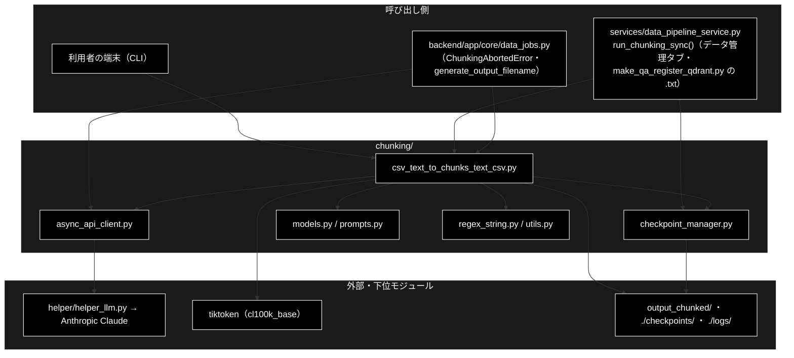

# README_chunking.md - chunking/ ディレクトリ概要

**Version 2.0** | 最終更新: 2026-10-11

`chunking/` の入口となる文書。ディレクトリの役割・モジュール索引・コマンドの早見表・組み合わせ方・既知の制約をまとめる。
文書を新しく書く／直す前に、まずここを見る。

> 📌 **データ準備 3 工程のうち ① チャンク化を担う。**
> ② Q/A 生成は [`qa_generation/`](../../qa_generation/docs/README.md)、③ Qdrant 登録は [`qa_qdrant/`](../../qa_qdrant/docs/README_qa_qdrant.md)。
> 運用手順の入口は [`README_DATA.md`](../../README_DATA.md)、環境構築は [`docs/data_prep_install.md`](../../docs/data_prep_install.md)。
>
> ⚠️ **本リポジトリは Anthropic 版。** チャンク化の LLM は Anthropic Claude（既定 `claude-haiku-5-5` = `config.py::ModelConfig.CHUNKING_MODEL`・
> `ANTHROPIC_API_KEY`）。姉妹リポジトリ `grace_v2_local` は Ollama 版で、`diagnose_ollama.py` など本リポジトリに無いモジュールと、
> 別物の `async_api_client.py` を持つ。文書をコピーで持ち込まないこと（CLAUDE.md §5）。

---

## 目次

- [概要](#概要)
  - [主な責務](#主な責務)
  - [各責務対応のモジュール](#各責務対応のモジュール)
  - [アーキテクチャ構成図](#アーキテクチャ構成図)
- [1. モジュール一覧（索引）](#1-モジュール一覧索引)
- [2. 使い方（代表的なワークフロー）](#2-使い方代表的なワークフロー)
- [3. 公開 API（__init__.py）](#3-公開-api__init__py)
- [4. 処理フロー・データフロー](#4-処理フローデータフロー)
- [5. 既知の制約・残課題](#5-既知の制約残課題)
- [6. 変更履歴](#6-変更履歴)

---

## 概要

`chunking/` は、テキスト（`.txt`・CSV）を **LLM で意味のまとまり（チャンク）に分け、チャンク CSV を書く**パッケージである。
分け方は 3 段階（Step1 段落分割 → Step2 意味的分割 → Step3 連続性チェック）で、最後に 1 チャンク 512 トークン（cl100k_base）の上限を掛ける。
出力の `<入力名>_chunks.csv` が ② Q/A 生成の入力になる。

### 主な責務

- 入力（`.txt` / CSV）の読み込みと、3 段階の LLM チャンク化・チャンク CSV の保存
- LLM 呼び出しの並列化・リトライ・連続失敗での中断
- 各段の途中結果の保存と、続きからの再開
- LLM に返させる JSON の形（スキーマ）の定義
- 各段で LLM に渡す指示文（プロンプト）の定義
- 正規表現による文分割（Step1 の前処理・後処理）
- ログ設定・表示の整形・呼び出し回数の見積もり

### 各責務対応のモジュール

| # | 責務 | 対応モジュール | 説明 |
|---|------|--------------|------|
| 1 | 読み込み・3 段階・保存 | `csv_text_to_chunks_text_csv.py` | CLI の入口。`chunks_all_async()` / `load_text_from_csv()` / `save_chunks_as_csv()` |
| 2 | 並列・リトライ・中断 | `async_api_client.py` | `AsyncAPIClient` / `ChunkingAbortedError` |
| 3 | 途中結果と再開 | `checkpoint_manager.py` | `CheckpointManager`（`./checkpoints/<JOB_ID>/step1〜3.json`） |
| 4 | 応答のスキーマ | `models.py` | `StructuralResult` / `ParagraphUnit` / `SentenceUnit` / `ContinuityResult` |
| 5 | 指示文 | `prompts.py` | `PARAGRAPH_SEPARATION_PROMPT` / `SEMANTIC_CHUNKING_PROMPT` / `CONTINUITY_CHECK_PROMPT` |
| 6 | 文分割 | `regex_string.py` | `chunk_text()` |
| 7 | 補助 | `utils.py` | `setup_logging()` / `format_size()` ほか |

### アーキテクチャ構成図



**データフロー**: 入力ファイル → 1 本のテキスト（CSV は行を空行でつなぐ）→ ブロック（1000 文字）→ 段落（Step1）→ チャンク（Step2）→ 結合（Step3）→
512 トークンの上限 → `<出力先>/<入力名>_chunks.csv`（8 列）と `_chunks_simple.csv`（`Text` 列）。詳細は §4。

---

## 1. モジュール一覧（索引）

| モジュール | 文書 | 種別 | 行数 | Ver | 概要 |
|---|---|---|---:|---|---|
| `csv_text_to_chunks_text_csv.py`（1004 行） | [`csv_text_to_chunks_text_csv.md`](csv_text_to_chunks_text_csv.md) | E | 1162 | 1.12 | CLI と 3 段階パイプライン・入出力。既知の問題 6 件（§5.3） |
| `async_api_client.py`（212 行） | [`async_api_client.md`](async_api_client.md) | E | 571 | 2.6 | 構造化出力つき非同期 LLM クライアント（Semaphore・リトライ・連続失敗で中断） |
| `checkpoint_manager.py`（237 行） | [`checkpoint_manager.md`](checkpoint_manager.md) | E | 371 | 1.0 | 段ごとの途中結果の保存と再開・ジョブの一覧と掃除 |
| `models.py`（50 行） | [`models.md`](models.md) | E | 243 | 1.0 | 応答のスキーマ（Pydantic） |
| `prompts.py`（100 行） | [`prompts.md`](prompts.md) | E | 197 | 1.0 | 3 段階の指示文 |
| `regex_string.py`（182 行） | [`regex_string.md`](regex_string.md) | E | 280 | 1.0 | 正規表現による文分割（日本語・英語） |
| `utils.py`（187 行） | [`utils.md`](utils.md) | E | 287 | 1.0 | ログ設定・表示の整形・呼び出し回数の見積もり |
| （処理フロー） | [`chunking_process_flow.md`](chunking_process_flow.md) | A | 208 | 1.0 | 3 つの入口から 3 段階・上限・保存まで。各段の失敗時の既定・中断・再開 |

> 行数は文書の行数（2026-10-11 実測）。`__init__.py`（101 行・再エクスポートだけ）は文書を作らない（§3）。
> データフロー（チャンク CSV の列・置き場所）は別文書にせず、§4 と [`qa_qdrant/docs/qa_qdrant_data_flow.md`](../../qa_qdrant/docs/qa_qdrant_data_flow.md) §2.1 に書く。
>
> **移した文書（2026-10-11）**: 旧 `README.md`（棚卸し索引）→ 本書、`memo.txt`（コマンドの早見表）→ 本書 §2.1 に取り込み、原本は
> [`archive/memo.txt`](archive/memo.txt)（既定モデルが `claude-haiku-4-5` のままなど古くなっていた）。

---

## 2. 使い方（代表的なワークフロー）

| # | ワークフロー | いつ使うか | 例 |
|---|------------|-----------|----|
| 1 | CLI の早見表（よく使うオプション） | コマンドをすぐ打ちたい | 2.1 |
| 2 | チャンク化 → Q/A 生成 → Qdrant 登録 | 文書をアプリで検索できるようにする | 2.2 |
| 3 | 本番の入口と同じ組み立て方（Python） | データ管理タブと同じ関数で動かす | 2.3 |

> 📝 **確かめ方（2026-10-11）**: 2.1〜2.3 は実行した。LLM（Anthropic）と Embedding（Gemini）はスタブ
> （段落分割は「。」で文に割るだけ・連続性は常に「つながらない」・ベクトルは文字列から決まる 3072 次元）、Qdrant は `docker compose` の実物。
> 入力は 4 文の `data/document.txt` と、`Combined_Text` 列を持つ 3 行の `OUTPUT/gov_faq.csv`。
> 各モジュールの使い方は、それぞれの文書の §4.1。

### 2.1 CLI の早見表

```bash
# 前提: .env に ANTHROPIC_API_KEY。正本は --help と csv_text_to_chunks_text_csv.md
# 基本（出力は <--output>/<入力名>_chunks.csv と _chunks_simple.csv。--output の既定は chunks_output）
python -m chunking.csv_text_to_chunks_text_csv --input-file data/document.txt --output output_chunked

# CSV を入力にする（本文の列を指定・先頭 2 行だけで試す）
python -m chunking.csv_text_to_chunks_text_csv --input-file OUTPUT/gov_faq.csv --output output_chunked --text-column Combined_Text --max-rows 2

# 並列数・モデル・ブロックの大きさを変える（既定: 8 / claude-haiku-5-5 / 1000 文字）
python -m chunking.csv_text_to_chunks_text_csv --input-file data/document.txt --output output_chunked --workers 3 --model claude-sonnet-5-5 --block-size 800

# 詳細ログ（コンソールも DEBUG。ログファイルは常に ./logs/chunking_<日時>.log）
python -m chunking.csv_text_to_chunks_text_csv --input-file data/document.txt --output output_chunked --verbose 2>/dev/null

# 中断したジョブを再開する（JOB_ID は ./checkpoints/ 配下のディレクトリ名。同じ入力で使う）
JOB_ID=$(ls -t checkpoints | head -1)
python -m chunking.csv_text_to_chunks_text_csv --input-file data/document.txt --output output_chunked --resume "$JOB_ID"

# ジョブの一覧（専用のオプションは無い）
python -c "from chunking.checkpoint_manager import CheckpointManager as C; print(len(C.list_jobs()) > 0)"

ls output_chunked

# 出力例（最後の 2 つ）:
# True
# document_chunks.csv
# document_chunks_simple.csv
# gov_faq_chunks.csv
# gov_faq_chunks_simple.csv
```

> 📌 並列は asyncio ＋ Semaphore（`--workers` 本まで）。リトライは最大 3 回（429・rate・quota は 30 秒・60 秒、それ以外は 1 秒・2 秒）。
> LLM 呼び出しが連続 3 回失敗すると `ChunkingAbortedError` で止まる（`CHUNKING_ABORT_AFTER_FAILURES`。0 で無効）。
> `--combine-rows` は効かない（§5 の 4）ので載せていない。

### 2.2 チャンク化 → Q/A 生成 → Qdrant 登録

```bash
# 1. チャンク化（ANTHROPIC_API_KEY）
python -m chunking.csv_text_to_chunks_text_csv --input-file data/document.txt --output output_chunked 2>/dev/null

# 2. Q/A 生成 → Qdrant 登録（ANTHROPIC_API_KEY・GOOGLE_API_KEY・Qdrant）
python qa_qdrant/make_qa_register_qdrant.py \
  --input-file output_chunked/document_chunks.csv \
  --collection document_qa --recreate 2>&1 | grep "データ件数"

# 出力例（スタブではチャンク 1 つにつき Q/A 1 件）:
# INFO:__main__:   データ件数  : 4 件
```

> 📌 `make_qa_register_qdrant.py` に `.txt` を渡すと 1 と 2 を 1 本でやる（ワーカー数 8・ブロック 1000 文字は固定で、`--resume` は無い）。
> 大きな文書は 1 をこの CLI で先にやり、途中で落ちたら `--resume` で続ける（[`qa_qdrant/docs/make_qa_register_qdrant.md`](../../qa_qdrant/docs/make_qa_register_qdrant.md) §5.1）。

### 2.3 本番の入口と同じ組み立て方（Python）

```python
from pathlib import Path
from chunking.csv_text_to_chunks_text_csv import generate_output_filename
from services.data_pipeline_service import run_chunking_sync

# データ管理タブの「① チャンキング」と make_qa_register_qdrant.py の .txt 入力が使う同期版
text = Path("data/document.txt").read_text(encoding="utf-8")
out = generate_output_filename("data/document.txt", "output_chunked")   # output_chunked/document_chunks.csv（ディレクトリも作る）
chunks = run_chunking_sync(
    text,
    model="claude-haiku-5-5",
    max_workers=8,
    block_size=1000,
    output_file=out,
    dataset_type="document",
    source_file="document.txt",
)
print(len(chunks), out)

# 実行結果（スタブ）:
# 4 output_chunked/document_chunks.csv
```

> ⚠️ チャンク化の中で LLM 呼び出しが連続して失敗すると `ChunkingAbortedError` が上がる。データ管理タブのジョブはこれを捕まえて
> エラーイベントにする（[`async_api_client.md`](async_api_client.md) §4.1.3）。`run_chunking_sync()` の引数は
> [`services/docs/data_pipeline_service.md`](../../services/docs/data_pipeline_service.md)。

---

## 3. 公開 API（__init__.py）

`chunking/__init__.py`（101 行）の `__all__` は 19 個（再エクスポート 18 個と `__version__`）。`__version__ = "1.2.0"`（パッケージの更新では上げていない）。

| 名前 | 定義元 | 用途 |
|---|---|---|
| `SentenceUnit` / `ParagraphUnit` / `StructuralResult` / `ContinuityResult` | `models.py` | 応答のスキーマ |
| `PARAGRAPH_SEPARATION_PROMPT` / `SEMANTIC_CHUNKING_PROMPT` / `CONTINUITY_CHECK_PROMPT` | `prompts.py` | 指示文 |
| `AsyncAPIClient` | `async_api_client.py` | LLM クライアント（`ChunkingAbortedError` は再エクスポートしない） |
| `CheckpointManager` | `checkpoint_manager.py` | 途中結果と再開 |
| `chunks_all_async` / `load_text_from_csv` / `save_chunks_as_csv` / `save_chunks_as_text` | `csv_text_to_chunks_text_csv.py` | 本体（`save_chunks_as_simple_csv` / `generate_output_filename` は再エクスポートしない） |
| `show_paragraphs` / `setup_logging` / `format_time` / `format_size` / `estimate_api_calls` | `utils.py` | 補助 |
| `__version__` | `__init__.py` | `"1.2.0"` |

> ⚠️ **`import chunking` だけで本体（`csv_text_to_chunks_text_csv.py`）と `pandas`・`tiktoken`・`tqdm`・`helper.helper_llm` が読み込まれる**（2026-10-11 に `sys.modules` で確認。`anthropic` は最初の呼び出しまで読まない）。
> 本番のコードはどれも `from chunking.<module> import ...` と個別に import していて、この再エクスポートを使っていない（2026-10-11 grep）。
> 副作用として、`python -m chunking.csv_text_to_chunks_text_csv` を実行すると最初に
> `RuntimeWarning: 'chunking.csv_text_to_chunks_text_csv' found in sys.modules after import of package 'chunking' ...` が出る（動作には影響しない）。

---

## 4. 処理フロー・データフロー

- **処理フロー** — [`chunking_process_flow.md`](chunking_process_flow.md)。3 つの入口（CLI・データ管理タブ・`.txt` 入力の Q/A 登録）から
  `chunks_all_async()` の Step1〜3・上限・保存までと、各段で LLM が失敗したときの既定（Step1・Step2 は**そのブロックを捨てる**、Step3 は「つながらない」扱い）、中断と再開。
- **データの形** — 入力 CSV は本文の列（指定が無ければ `text` → `content` → `Combined_Text` → `body` → `document` → `answer` の順に探し、大文字小文字の変種も見る。
  無ければ最初の列）の非空セルを `"\n\n"` でつなぐ。出力は 8 列（`chunk_id` = `<入力名>_chunk_<n>` / `text`（改行は空白へ）/ `tokens` / `chunk_idx` /
  `dataset_type` = 入力名 / `type` = `llm_chunk` / `sentence_count` / `source_file`）と、`Text` 1 列の簡易版。
  後続での読まれ方は [`qa_qdrant/docs/qa_qdrant_data_flow.md`](../../qa_qdrant/docs/qa_qdrant_data_flow.md) §2.1。

| 出力 | 置き場所 | 上書き |
|------|---------|:-----:|
| チャンク CSV・簡易版 | `<--output>/<入力名>_chunks.csv` / `_chunks_simple.csv`（`--output` の既定 `chunks_output`） | する（CLAUDE.md §8.2） |
| チェックポイント | `./checkpoints/<JOB_ID>/step1〜3.json`（カレント基準） | しない（実行ごとに増え、自動では消えない） |
| ログ | `./logs/chunking_<日時>.log`（CLI だけ） | しない（実行ごとに増える） |

---

## 5. 既知の制約・残課題

2026-10-11 に実装を読み、LLM をスタブにして CLI を動かして確かめた。**コードは直していない**（本書の改訂は文書の整理のみ）。

| # | 内容 | 影響 | 詳細 |
|---|------|------|------|
| 1 | **1 ブロックの LLM 呼び出しが失敗すると、その本文が黙って消える**（終了コード 0。ログの `Using fallback.` に対応する処理は無い） | 文書の一部が Q/A・検索の対象から外れる | [`csv_text_to_chunks_text_csv.md`](csv_text_to_chunks_text_csv.md) §5.3 の 1 |
| 2 | `--resume` がジョブと入力ファイルの対応を確かめない | 別の入力で再開すると、前のジョブのチャンクが新しい入力名の CSV になる | 同 §5.3 の 2 |
| 3 | 入力ファイルが無くても CLI の終了コードが 0 | シェル・ジョブから失敗を検知できない | 同 §5.3 の 3 |
| 4 | `--combine-rows` が効かない | オプションが何もしない | 同 §5.3 の 4 |
| 5 | Step1 のブロックが文や語の途中で切れる | 境目の文が 2 チャンクに割れることがある | 同 §5.3 の 5 |
| 6 | `chunking/requirements.txt` が古い（`google-genai` を挙げ、実際に要る `anthropic`・`tiktoken`・`pandas` が無い） | 書かれたとおりに入れても動かない。依存の正本はリポジトリ直下の `pyproject.toml` | — |
| 7 | `import chunking` で本体まで読み込み、`python -m` で `RuntimeWarning` が出る | 見た目と import の重さ | §3 |
| 8 | 移植前の記述が残る（`models.py` / `prompts.py` の docstring の「Gemini API」、`AsyncAPIClient.get_stats()` の `truncated_responses` は常に 0、`utils.show_paragraphs()` は何もしない） | 読む人が誤解する | 各モジュールの文書 |

> 1〜3 は出力の中身や成否が静かに食い違う問題なので、直すときは修正前のコードで fail するテストを先に書く（CLAUDE.md の作業原則）。

### 5.1 文書を保守するときの約束とテスト件数

| 置き場所 | 書くもの | 書かないもの |
|---|---|---|
| `<module>.md` | IPO（入出力・副作用・使用例） | 運用判断・ほかのモジュールの仕様 |
| 本書 §2 | コマンドの早見表と、モジュールを組み合わせる流れ | 1 モジュールの IPO |
| 直下 `README_DATA.md` / `docs/data_prep_install.md` | 3 工程を通した運用手順・環境構築 | 1 モジュールの IPO |

- CLI のオプションを変えたら、同じコミットで本書 §2.1 と [`csv_text_to_chunks_text_csv.md`](csv_text_to_chunks_text_csv.md) §4.5 を直す（旧 `memo.txt` は CLI の変更に置いていかれた）
- 使用例は**動かして確かめてから**載せる（`a_class_method_md_format.md` §9.5）。LLM はスタブでよい

テスト件数（2026-10-11 に `pytest --collect-only` で数えた値）:

| テストファイル | 件数 | 対象 |
|---|---:|---|
| `tests/test_chunking_abort.py` | 5 | `AsyncAPIClient` の連続失敗での中断・カウントの戻し・0 で無効・環境変数の既定 |
| `tests/test_chunking_default_model.py` | 5 | チャンク化の既定モデルが `ModelConfig.CHUNKING_MODEL` を参照すること |
| `tests/test_data_jobs.py` | 44 | データ管理タブのジョブ全体（チャンク化ジョブの runner・入力検証を含む・**間接**） |
| `tests/test_model_table_coverage.py` | 5 | CLI `--model` の既定が単価・上限表に載っていること（**間接**） |

```bash
uv run --no-sync pytest tests/test_chunking_abort.py tests/test_chunking_default_model.py -q
# 2026-10-11 実測: 10 passed
```

> ⚠️ 3 段階パイプライン（`chunks_all_async()`）・`CheckpointManager`・`regex_string`・`utils` を**直接**検証するテストは無い。

---

## 6. 変更履歴

| バージョン | 日付 | 変更内容 |
|---|---|---|
| 1.0 | 2026-09-25 | 新規作成（旧名 `chunking/docs/README.md`・棚卸し索引）。文書一覧・実装カバレッジ・テスト件数・残タスクを記載 |
| 1.1〜1.7 | 2026-09-25〜2026-10-11 | `async_api_client.md` の既定モデルの是正、Embedding・軽量モデルの変更への追随、テストの所在の移動、`services/docs/`・`qa_qdrant/docs/` の改名への追随（各版の内容は git 履歴） |
| 2.0 | 2026-10-11 | `a_cross_doc_md_format.md` §1.1〜§1.4 に合わせて `README_chunking.md` へ改名し、共通骨格（主な責務・各責務対応のモジュール・3 層構成図）を持つ構成に書き直した。専用の文書が無かった 5 モジュール（`checkpoint_manager` / `models` / `prompts` / `regex_string` / `utils`）の文書と `chunking_process_flow.md` を新設し、`memo.txt` を §2.1 に取り込んで `archive/` へ移した。§2 のワークフロー 3 本を実行して確かめ、実測で見つけた制約 8 件を §5 に、テスト件数を数え直して §5.1 に記録した |
