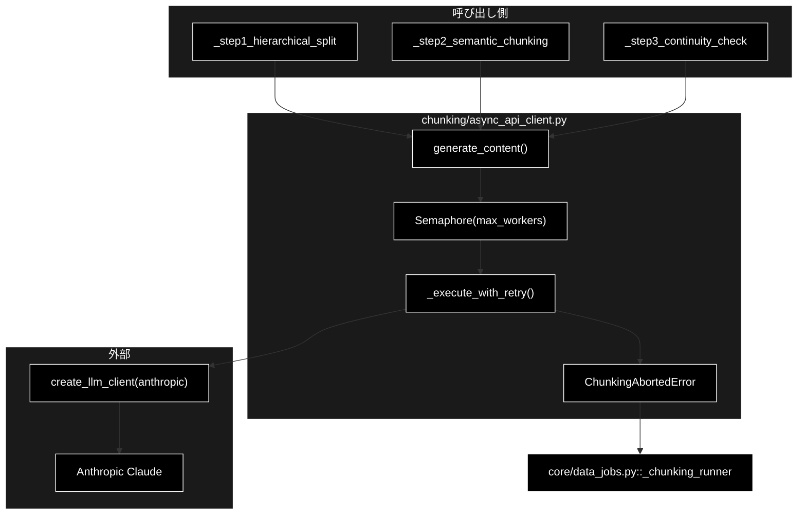
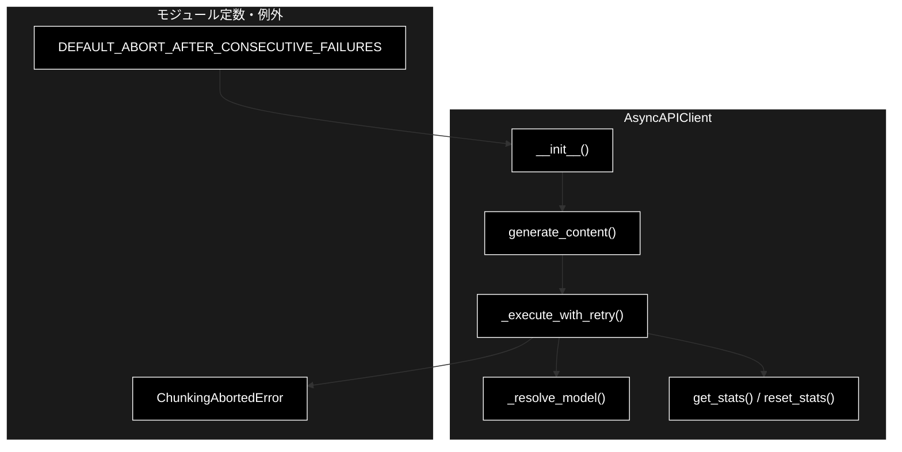
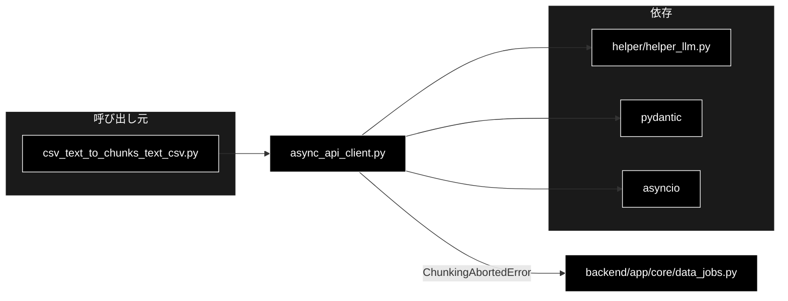

# async_api_client.py - チャンク化用 非同期APIクライアント ドキュメント

**Version 2.7** | 最終更新: 2026-10-11

---

## 目次

1. [概要](#概要)
2. [アーキテクチャ構成図](#1-アーキテクチャ構成図)
3. [モジュール構成図](#2-モジュール構成図)
4. [クラス・関数一覧表](#3-クラス関数一覧表)
5. [クラス・関数 IPO詳細](#4-クラス関数-ipo詳細)
6. [設定・定数](#5-設定定数)
7. [エクスポート](#6-エクスポート)
8. [変更履歴](#7-変更履歴)
9. [付録: 依存関係図](#付録-依存関係図)

---

## 概要

`chunking/async_api_client.py` は、チャンク化の 3 段階（階層分割 → 意味チャンク化 → 連続性チェック）
から呼ばれる**構造化出力つき非同期 LLM クライアント**である。

LLM は **Anthropic Claude**（本クライアントはチャンク化専用なので、既定は軽量の `claude-haiku-5-5` = `config.py::ModelConfig.CHUNKING_MODEL`。`DEFAULT_MODEL` とは別・`ANTHROPIC_API_KEY`）。
同期の `create_llm_client("anthropic").generate_structured()` を
`asyncio.to_thread()` でラップし、`asyncio.Semaphore` で並列数を絞る。

> ⚠️ **v1.0 の本書は Gemini 時代の記述だった**（`genai.Client` / `_is_valid_json()` /
> `_is_truncated_response()` など、**現在は存在しないメソッド**を載せていた）。
> v2.0 で実装（210 行）と突き合わせて全面的に書き直している。

### 主な責務

- 構造化出力（Pydantic スキーマ準拠）の生成を**非同期で**行う
- `Semaphore` で並列実行数を絞る
- 指数バックオフでリトライする（レート制限は待ち時間を延ばす）
- **連続失敗が続いたらチャンク化を中断する**（`ChunkingAbortedError`）
- 呼び出し統計を収集する

### 各責務対応のモジュール

| # | 責務 | 対応モジュール | 説明 |
|---|------|--------------|------|
| 1 | 構造化出力を非同期で生成する | 本モジュール（`generate_content()`）＋ `helper/helper_llm.py` | `create_llm_client("anthropic")` の `generate_structured()` を `asyncio.to_thread()` で包む |
| 2 | 並列実行数を絞る | 本モジュール（`__init__()` / `generate_content()`） | `asyncio.Semaphore(max_workers)` |
| 3 | 指数バックオフでリトライする | 本モジュール（`_execute_with_retry()`） | 通常 `2^attempt` 秒、レート制限は `30×(attempt+1)` 秒待つ |
| 4 | 連続失敗が続いたらチャンク化を中断する | 本モジュール（`ChunkingAbortedError`）→ `backend/app/core/data_jobs.py` | 連続失敗数で中断し、ジョブ側が error イベントへ変換する |
| 5 | 呼び出し統計を収集する | 本モジュール（`get_stats()` / `reset_stats()`） | 総数・失敗数などを集計 |

### 主要機能一覧

| 機能 | 説明 |
|------|------|
| `DEFAULT_ABORT_AFTER_CONSECUTIVE_FAILURES` | 連続失敗の既定許容回数（環境変数で変更可） |
| `ChunkingAbortedError` | 連続失敗による中断。**握りつぶしてはいけない** |
| `AsyncAPIClient` | 非同期クライアント本体 |
| `AsyncAPIClient.generate_content()` | セマフォ制御つきの構造化出力生成 |
| `AsyncAPIClient._execute_with_retry()` | リトライと中断判断（プライベート） |
| `AsyncAPIClient._resolve_model()` | 非 Claude 名を既定モデルへ回避（静的メソッド） |
| `AsyncAPIClient.get_stats()` / `reset_stats()` | 統計の取得・リセット |

---

## 1. アーキテクチャ構成図

### 1.1 システム全体構成



### 1.2 データフロー

1. 3 段階のいずれかが `generate_content(model, contents, response_schema, task_id)` を呼ぶ
2. `Semaphore` が空くまで待つ（同時実行は `max_workers` 件まで）
3. `_execute_with_retry()` が `asyncio.to_thread()` で同期の `generate_structured()` を呼ぶ
4. 成功 → Pydantic インスタンスを `model_dump_json()` した**文字列**を返し、連続失敗カウントを 0 に戻す
5. 失敗 → 指数バックオフで `max_retries` 回まで再試行
6. 使い切ったら連続失敗カウントを 1 増やし、
   **上限に達していれば `ChunkingAbortedError` を送出**。達していなければ `None` を返す
   （呼び出し側の Step1・Step2 はそのブロックの本文を捨てて次へ進む。代わりの処理は無い・§4.1.3）

---

## 2. モジュール構成図

### 2.1 内部モジュール構成



### 2.2 外部依存関係

| ライブラリ | 用途 |
|-----------|------|
| `pydantic` | `BaseModel`（レスポンススキーマの型） |

### 2.3 標準ライブラリ依存

| モジュール | 用途 |
|-----------|------|
| `asyncio` | `to_thread` / `Semaphore` / `sleep` |
| `logging` | リトライ・失敗のログ |
| `os` | `CHUNKING_ABORT_AFTER_FAILURES` の読み取り |

### 2.4 内部依存モジュール

| モジュール | 用途 |
|-----------|------|
| `helper.helper_llm.create_llm_client` | LLM クライアント生成（`provider="anthropic"`） |

---

## 3. クラス・関数一覧表

### 3.1 クラス一覧

#### ChunkingAbortedError

`RuntimeError` のサブクラス。LLM 呼び出しが連続で失敗したためチャンク化を中断したことを表す。

> ⚠️ **握りつぶしてフォールバックで続行してはいけない。** 続行しても、
> LLM を使わない機械的な分割結果しか得られない。
> 捕捉は `backend/app/core/data_jobs.py::_chunking_runner` が行い、error イベントへ変換する。

#### AsyncAPIClient

| メソッド | 概要 |
|---------|------|
| `__init__(api_key, max_workers, max_retries, max_output_tokens, default_model, abort_after_consecutive_failures)` | コンストラクタ |
| `_resolve_model(model, default_model)` | 非 Claude 名を既定モデルへ回避（`@staticmethod`） |
| `generate_content(model, contents, response_schema, task_id)` | セマフォ制御つきの生成（`async`） |
| `_execute_with_retry(model, contents, response_schema, task_id)` | リトライと中断判断（`async`） |
| `get_stats()` | 統計情報を取得 |
| `reset_stats()` | 統計情報をリセット |

### 3.2 関数一覧

モジュールレベル関数はない。

---

## 4. クラス・関数 IPO詳細

### 4.1 使用例

| # | パターン | いつ使うか | 例 |
|---|---------|-----------|----|
| 1 | **基本**: 1 件を構造化出力で呼び、検証して読む | チャンク化の各段と同じ使い方 | 4.1.1 |
| 2 | 並列に投げて統計を見る | 多数のブロックを `max_workers` 本ずつ処理する | 4.1.2 |
| 3 | 失敗したとき（1 件だけ失敗・連続失敗で中断・中断を無効にする） | API の不調・キーの誤り | 4.1.3 |
| 4 | モデル名の扱い（Claude 以外の名前は既定へ回避） | 古い設定から Gemini のモデル名が渡ってきた | 4.1.4 |

> 📝 **確かめ方（2026-10-11）**: 4.1.1〜4.1.4 はすべて実行した。LLM（Anthropic）はスタブに差し替えた
> （段落分割の依頼には入力を「。」で文に割って返し、環境変数 `FAKE_FAIL_SUBSTR` を含む依頼だけ例外を投げる）。
> リトライの待ち（1 回目の失敗後 1 秒・2 回目の後 2 秒）は実際に待つので、4.1.3 は数秒かかる。最後の試行のあとは待たないが、
> ログには `Retrying in 4s (attempt 3/3)` と出る（文言だけ。`max_retries=1` でも `Retrying in 1s` と出る）。

#### 4.1.1 基本: 1 件を構造化出力で呼び、検証して読む

```python
import asyncio
from chunking.async_api_client import AsyncAPIClient
from chunking.models import StructuralResult
from chunking.prompts import PARAGRAPH_SEPARATION_PROMPT

client = AsyncAPIClient(max_workers=8, max_retries=3, max_output_tokens=16384)   # 既定モデルは ModelConfig.CHUNKING_MODEL

json_text = asyncio.run(client.generate_content(
    model="claude-haiku-5-5",
    contents=f"{PARAGRAPH_SEPARATION_PROMPT}\n\n【入力テキスト】\n住民票は区役所で取れます。手数料は300円です。",
    response_schema=StructuralResult,
    task_id="step1_block_0",
))
result = StructuralResult.model_validate_json(json_text)   # 戻り値は検証済みの JSON 文字列
print([p.full_text for p in result.paragraphs])

# 実行結果（スタブ）:
# ['住民票は区役所で取れます。', '手数料は300円です。']
```

#### 4.1.2 並列に投げて統計を見る

```python
import asyncio
from chunking.async_api_client import AsyncAPIClient
from chunking.models import ContinuityResult
from chunking.prompts import CONTINUITY_CHECK_PROMPT

client = AsyncAPIClient(max_workers=2)        # 同時に走る呼び出しは 2 本まで（Semaphore）
pairs = [("住民票は区役所で取れます。", "手数料は300円です。")] * 5

async def run():
    tasks = [
        client.generate_content(
            model="claude-haiku-5-5",
            contents=f"{CONTINUITY_CHECK_PROMPT}\n\n【前のテキスト】\n{a}\n\n【次のテキスト】\n{b}",
            response_schema=ContinuityResult,
            task_id=f"step3_pair_{i}",
        )
        for i, (a, b) in enumerate(pairs)
    ]
    return await asyncio.gather(*tasks)

results = asyncio.run(run())
print(len(results), ContinuityResult.model_validate_json(results[0]).is_connected)
print(client.get_stats())

# 実行結果（スタブ）:
# 5 False
# {'total_requests': 5, 'failed_requests': 0, 'truncated_responses': 0, 'success_rate': 100.0, 'concurrency': 2}
```

> 📌 `truncated_responses` は数える処理が無く、常に 0（Gemini 時代の名残）。

#### 4.1.3 失敗したとき

```python
import asyncio, os
from chunking.async_api_client import AsyncAPIClient, ChunkingAbortedError
from chunking.models import StructuralResult

def call(client, text, i):
    return client.generate_content("claude-haiku-5-5", f"【入力テキスト】\n{text}", StructuralResult, task_id=f"block_{i}")

os.environ["FAKE_FAIL_SUBSTR"] = "失敗"          # スタブ: この文字列を含む依頼だけ例外を投げる

# (a) 1 件だけ失敗 → リトライ 3 回のあと None（例外にはならない）
client = AsyncAPIClient(max_retries=3, abort_after_consecutive_failures=3)
print(asyncio.run(call(client, "失敗するブロック。", 0)))
print(client.get_stats()["failed_requests"])

# (b) 続けて失敗 → (a) と合わせて連続 3 件目で ChunkingAbortedError（呼び出し側はこれで処理全体を止める）
async def many(client):
    for i in range(1, 4):
        await call(client, "失敗するブロック。", i)
try:
    asyncio.run(many(client))
except ChunkingAbortedError as e:
    print(type(e).__name__, str(e).splitlines()[0])

# (c) abort_after_consecutive_failures=0 なら何回失敗しても止めない（環境変数 CHUNKING_ABORT_AFTER_FAILURES=0 と同じ）
client0 = AsyncAPIClient(max_retries=1, abort_after_consecutive_failures=0)
print([asyncio.run(call(client0, "失敗するブロック。", i)) for i in range(4)])

# 実行結果（スタブ）:
# None
# 1
# ChunkingAbortedError LLM 呼び出しが 3 回連続で失敗したためチャンク化を中断しました。最後のエラー: 500 Internal Server Error (stub)
# [None, None, None, None]
```

> 📌 **`None` を受け取ったチャンク化の Step1・Step2 は、そのブロック（段落）を分割せずに原文のまま残す**（2026-10-11〜。
> [`csv_text_to_chunks_text_csv.md`](csv_text_to_chunks_text_csv.md) §4.1.5）。ログの `Using fallback.` はこれを指す。
> それより前は本文を**捨てて先へ進んでいた**（同 §5.3 の 1）。v2.5 までの本書の例は「機械的分割へフォールバック」と書いていたが、そのような処理は無かった。
>
> 📌 データ管理タブのチャンク化ジョブ（`backend/app/core/data_jobs.py::_chunking_runner`）は `ChunkingAbortedError` を捕まえ、
> メッセージをそのままエラーイベントにする。

#### 4.1.4 モデル名の扱い

```python
from chunking.async_api_client import AsyncAPIClient

# Claude 以外の名前（例: 古い設定の gemini-2.5-flash）・None は、既定モデルへ黙って置き換える
print(AsyncAPIClient._resolve_model("gemini-2.5-flash", "claude-haiku-5-5"))
print(AsyncAPIClient._resolve_model(None, "claude-haiku-5-5"))
print(AsyncAPIClient._resolve_model("claude-sonnet-5-5", "claude-haiku-5-5"))

# 実行結果:
# claude-haiku-5-5
# claude-haiku-5-5
# claude-sonnet-5-5
```

### 4.2 `AsyncAPIClient.__init__`

**概要**: LLM クライアント・Semaphore・中断しきい値・統計カウンタを用意する。

```python
AsyncAPIClient(
    api_key: Optional[str] = None,
    max_workers: int = 8,
    max_retries: int = 3,
    max_output_tokens: int = 8192,
    default_model: str = ModelConfig.CHUNKING_MODEL,  # = "claude-haiku-5-5"
    abort_after_consecutive_failures: Optional[int] = None,
)
```

| パラメータ | 型 | デフォルト | 説明 |
|------------|------|-----------|------|
| `api_key` | Optional[str] | None | **未使用**（後方互換のため残置）。実際は `ANTHROPIC_API_KEY` を参照 |
| `max_workers` | int | 8 | 並列実行数（Semaphore 制御） |
| `max_retries` | int | 3 | 1 呼び出しあたりの最大リトライ回数 |
| `max_output_tokens` | int | 8192 | 出力トークン制限 |
| `default_model` | str | `ModelConfig.CHUNKING_MODEL`（`claude-haiku-5-5`） | 既定 Claude モデル（`chunks_all_async()` は選んだモデルをここにも渡す） |
| `abort_after_consecutive_failures` | Optional[int] | None | 連続失敗の許容回数。None なら `DEFAULT_ABORT_AFTER_CONSECUTIVE_FAILURES`。**0 で中断を無効** |

| 項目 | 内容 |
|------|------|
| **Input** | 上記パラメータ |
| **Process** | ① `create_llm_client("anthropic", default_model=...)`<br>② `asyncio.Semaphore(max_workers)`<br>③ 中断しきい値の決定<br>④ 統計カウンタの初期化 |
| **Output** | `AsyncAPIClient` インスタンス |

**インスタンス属性**:

| 属性 | 型 | 説明 |
|------|-----|------|
| `llm` | LLM クライアント | `create_llm_client("anthropic", ...)` の戻り |
| `default_model` | `str` | 既定モデル |
| `max_workers` / `semaphore` | `int` / `asyncio.Semaphore` | 並列制御 |
| `max_retries` / `max_output_tokens` | `int` | リトライ・出力上限 |
| `abort_after_consecutive_failures` | `int` | 中断しきい値（0 で無効） |
| `_consecutive_failures` | `int` | **連続**失敗回数。成功で 0 に戻る |
| `_total_requests` / `_failed_requests` / `_truncated_responses` | `int` | 統計 |

### 4.3 `AsyncAPIClient._resolve_model`

**概要**: 渡されたモデル名が Claude 系でなければ既定モデルへ回避する。

```python
@staticmethod
def _resolve_model(model: Optional[str], default_model: str) -> str
```

| 項目 | 内容 |
|------|------|
| **Input** | `model`（呼び出し側の指定）、`default_model` |
| **Process** | `model` が `claude` で始まれば採用、それ以外は `default_model` |
| **Output** | 実際に使うモデル名 |

> 📝 チャンク化の呼び出し側にはレガシーで Gemini モデル名を渡す経路が残っている。
> Anthropic エンドポイントへ非 Claude 名を投げて失敗しないための保護である。

### 4.4 `AsyncAPIClient.generate_content`

**概要**: セマフォで並列数を絞りつつ構造化出力を生成する。

```python
async def generate_content(
    model: str,
    contents: str,
    response_schema: Type[BaseModel],
    task_id: Optional[str] = None,
) -> Optional[str]
```

| 項目 | 内容 |
|------|------|
| **Input** | モデル名、プロンプト、レスポンススキーマ、タスク識別子（ログ用） |
| **Process** | `async with self.semaphore:` の中で `_execute_with_retry()` を呼ぶ |
| **Output** | 検証済み JSON **文字列**、または `None`（全リトライ失敗） |

**戻り値例**:

```python
'{"blocks": ["第1節 …", "第2節 …"]}'
```

> 📝 **戻り値は Pydantic インスタンスではなく JSON 文字列。** 呼び出し側が
> `model_validate_json()` でパースする契約を、Gemini 時代から維持している。

### 4.5 `AsyncAPIClient._execute_with_retry`

**概要**: リトライと**中断判断**。本モジュールの中核。

| 項目 | 内容 |
|------|------|
| **Input** | モデル名、プロンプト、レスポンススキーマ、`task_id` |
| **Process** | ① `_resolve_model()`<br>② `max_retries` 回ループし `asyncio.to_thread(generate_structured, ...)`<br>③ 成功したら `_consecutive_failures = 0` にして JSON 文字列を返す<br>④ 失敗は指数バックオフで待つ（レート制限は長め）<br>⑤ 使い切ったら `_failed_requests` と `_consecutive_failures` を加算<br>⑥ しきい値に達していれば `ChunkingAbortedError`、達していなければ `None` |
| **Output** | JSON 文字列 / `None`。中断時は `ChunkingAbortedError` |

**リトライ待機時間**:

| 状況 | 判定 | 待機時間 |
|------|------|---------|
| レート制限 | エラー文字列に `429` / `rate` / `quota` | `30 * (attempt + 1)` 秒（30・60・90） |
| それ以外 | — | `2 ** attempt` 秒（1・2・4） |

#### なぜ中断が要るのか

`None` を返して次のブロックへ進む（呼び出し側はそのブロックを分割せず原文のまま残す・§4.1.3）は、
**1 ブロックだけ落ちたとき**には正しい。しかし

- API キー切れ・権限不足
- モデル名の誤り
- ネットワーク断・継続的なレート制限

のように**全ブロックで等しく失敗する**原因では話が別で、1 ブロックあたり
`max_retries` 回ぶんの待ちを払い続けたうえ、**LLM を一度も使えていないのに
「成功」した CSV** が出来上がる。ブロック数が多いほど被害が大きい
（姉妹リポジトリ grace_v2_local では 1229 ブロックを 185 時間かけて処理し、
中身のない CSV を書き出した。実測 2026-09-06）。

**連続**失敗で数えるのが要点で、途中で 1 件でも成功すればカウントは 0 に戻る。
単発の失敗が積み上がって止まることはない。

回帰は `tests/test_chunking_abort.py` で固定している。

### 4.6 `AsyncAPIClient.get_stats` / `reset_stats`

| 項目 | 内容 |
|------|------|
| **Input** | なし |
| **Process** | カウンタから成功率を計算（取得）／ カウンタを 0 に戻す（リセット） |
| **Output** | `{"total_requests", "failed_requests", "truncated_responses", "success_rate", "concurrency"}` / `None` |

**戻り値例**:

```python
{"total_requests": 338, "failed_requests": 0, "truncated_responses": 0,
 "success_rate": 100.0, "concurrency": 8}
```

> 📝 `_truncated_responses` は Gemini 時代の切断検出で使っていたカウンタで、
> 現在は**常に 0**。統計の形を変えないために残してある。

---

## 5. 設定・定数

### 5.1 デフォルト設定値

| 設定 | デフォルト値 | 説明 |
|-----|-------------|------|
| `max_workers` | 8 | 並列実行数 |
| `max_retries` | 3 | 最大リトライ回数 |
| `max_output_tokens` | 8192 | 出力トークン制限（呼び出し側は 16384 を渡す） |
| `default_model` | `ModelConfig.CHUNKING_MODEL`（`claude-haiku-5-5`） | 既定モデル |

### 5.2 `DEFAULT_ABORT_AFTER_CONSECUTIVE_FAILURES`

```python
DEFAULT_ABORT_AFTER_CONSECUTIVE_FAILURES = int(
    os.getenv("CHUNKING_ABORT_AFTER_FAILURES", "3")
)
```

| 値 | 挙動 |
|---|---|
| `3`（既定） | 3 ブロック連続で失敗したら中断する |
| `0` | 中断しない（失敗したブロックを捨てて進む） |
| `1` | 最初の失敗で中断する |

### 5.3 レート制限の判定キーワード

エラーメッセージ（小文字化）に `429` / `rate` / `quota` のいずれかが含まれるとき、
レート制限として待ち時間を延ばす。


---

## 6. エクスポート

`__all__` の定義はない。公開要素は以下のとおり。

```python
DEFAULT_ABORT_AFTER_CONSECUTIVE_FAILURES   # 連続失敗の既定許容回数
ChunkingAbortedError                       # 連続失敗による中断
AsyncAPIClient                             # 非同期クライアント
```

---

## 7. 変更履歴

| バージョン | 日付 | 変更内容 |
|---|---|---|
| 1.0 | 2025-01-29 | 初版作成（Gemini `genai.Client` 前提）（2025-01-29） |
| 2.0 | 2026-09-12 | **実装と突き合わせて全面改訂。** v1.0 は Gemini 時代のままで、現在は存在しない `_is_valid_json()` / `_is_truncated_response()` / `genai.Client` を載せていた。あわせて `ChunkingAbortedError` と `DEFAULT_ABORT_AFTER_CONSECUTIVE_FAILURES` を追加記述（2026-09-12） |
| 2.1 | 2026-09-24 | 使用例を IPO 詳細の冒頭（`### 4.1 使用例`）へ移し、末尾の「## 6. 使用例」章を削除（基本フォーマット `a_class_method_md_format.md` v1.6〜 §6.1 に準拠。2026-09-24）。IPO の小節を 4.2 以降へ繰り下げ、後続の章番号を 1 つ繰り上げた。文書内の `§4.x` 参照も追随。あわせて「各責務対応のモジュール」を主な責務と同じ順・同じ粒度に並べ直した（行数は一致していたが、2〜5 行目の対応がずれていた） |
| 2.2 | 2026-09-25 | 既定モデルの記述（5 箇所）を実装（`async_api_client.py` の `default_model`）に合わせて旧既定 `claude-sonnet-4-6` → `claude-sonnet-5` へ是正（2026-09-25） |
| 2.3 | 2026-10-08 | 既定モデル（`default_model`）がコード側で `config.py::ModelConfig.DEFAULT_MODEL` 参照になったのに追随し、記述（5 箇所）を `claude-sonnet-5` → `claude-sonnet-5-5` へ是正（チャンク化は呼び出し側が軽量 `claude-haiku-5-5` を渡す）（2026-10-08） |
| 2.4 | 2026-10-08 | チャンキングの既定を、回答生成・Q/A 生成の `ModelConfig.DEFAULT_MODEL` から分けた `config.py::ModelConfig.CHUNKING_MODEL`（`claude-haiku-5-5`）の 1 箇所で決めるようにしたのに追随（2026-10-08） |
| 2.5 | 2026-10-10 | テストの所在を `backend/tests/` からリポジトリ直下の `tests/` へ移したのに追随（パス・コマンド・import の表記） |
| 2.6 | 2026-10-11 | `chunking/docs/` の構成整理に合わせて §4.1 を書き直した。v2.5 までの例はトップレベルの `await`・未定義の `Step1Response`・存在しない「機械的分割へのフォールバック」を書いており、そのままでは動かなかった。処理パターン（基本・並列と統計・失敗時〔1 件・連続で中断・中断を無効〕・モデル名の回避）ごとの 4 本にし、LLM をスタブにして実行して確かめた。`None` を受けた側に代わりの処理が無いこと、`truncated_responses` が常に 0 であることを記録 |
| 2.7 | 2026-10-11 | チャンク化の Step1・Step2 が、`None`（リトライし尽くした失敗）を受けたブロック・段落を原文のまま残すようになったのに合わせ、§4.1.3 の注記と「なぜ中断が要るのか」の「捨てる」の記述を直した |

---

## 付録: 依存関係図


