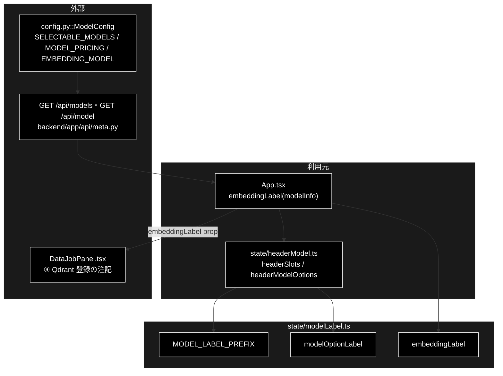

# modelLabel.ts - モデル選択肢のラベル ドキュメント

**Version 1.0** | 最終更新: 2026-10-12

---

## 目次

- [概要](#概要)
- [1. アーキテクチャ構成図](#1-アーキテクチャ構成図)
- [2. エクスポート一覧](#2-エクスポート一覧)
- [3. 判断の規則](#3-判断の規則)
- [4. テスト](#4-テスト)
- [5. 変更履歴](#5-変更履歴)

---

## 概要

| 項目 | 内容 |
|---|---|
| ファイル | `frontend/src/state/modelLabel.ts`（42 行） |
| 種別 | 純ロジック（表示文字列） |
| 利用元 | `state/headerModel.ts`（ヘッダーの見出し・選択肢）/ `App.tsx`（Embedding の注記 → `DataPanel` → `DataJobPanel`） |
| 対応バックエンド | `GET /api/models`（`ModelChoice.input_price` / `output_price`）/ `GET /api/model`（`ModelInfo.embedding_model` / `embedding_dims`）— `backend/app/api/meta.py` |

ヘッダーのモデルセレクタの見出しと選択肢のラベル、データ管理タブ「③ Qdrant 登録」の Embedding の注記を組み立てる。

> ⚠️ **既定のモデル名・Embedding のモデル名をこのファイル（と frontend 全体）に書かない。** 値は必ず API から来る
> （`config.py::ModelConfig`）。以前は Embedding のモデル名を画面に直書きしていて、サーバー側を変えても表示だけ古いまま残った。
>
> ⚠️ **grace_v2_local の同名ファイルとは中身が別物**（あちらは Ollama の `supports_tool_calls` / `notes` を畳み込む）。
> コピーで行き来させない（CLAUDE.md §5）。

### 主な責務

- ヘッダーの見出し文字列を 1 か所で持つ
- 選択肢のラベルに入力・出力単価を添える
- Embedding のモデル名と次元を API の値のまま表示文字列にする

### 各責務対応のモジュール

| # | 責務 | 対応モジュール | 説明 |
|---|---|---|---|
| 1 | 見出し | `MODEL_LABEL_PREFIX` | `利用モデル名：`（エージェントの 3 タブ） |
| 2 | 単価つきラベル | `modelOptionLabel` | `{id}（入力 ${in}／出力 ${out} per 1K）`。どれを選ぶと高くつくかを画面で分かるようにする |
| 3 | Embedding の表示 | `embeddingLabel` | `{model}・{dims} 次元`。次元 0 ならモデル名だけ、未取得なら `''` |

---

## 1. アーキテクチャ構成図

### 1.1 位置づけ



---

## 2. エクスポート一覧

```ts
export const MODEL_LABEL_PREFIX = '利用モデル名：';

export function modelOptionLabel(model: {
  id: string;
  input_price: number;
  output_price: number;
}): string

export function embeddingLabel(info: { embedding_model: string; embedding_dims: number } | null): string
```

`modelOptionLabel` には `types.ts` の `ModelChoice`、`embeddingLabel` には `ModelInfo | null` をそのまま渡せる。

---

## 3. 判断の規則

### 3.1 使用例

値は 2026-10-12 時点の `GET /api/models` / `GET /api/model` が返すもの（`config.py::ModelConfig` から）。

```ts
import { embeddingLabel, MODEL_LABEL_PREFIX, modelOptionLabel } from '../../src/state/modelLabel';

console.log(MODEL_LABEL_PREFIX);
console.log(modelOptionLabel({ id: 'claude-sonnet-5-5', input_price: 0.002, output_price: 0.01 }));
console.log(embeddingLabel({ embedding_model: 'gemini-embedding-001', embedding_dims: 3072 }));
console.log(embeddingLabel({ embedding_model: 'gemini-embedding-001', embedding_dims: 0 })); // 次元を返さない旧サーバー
console.log(JSON.stringify(embeddingLabel(null)));                                        // 未取得・取得失敗
```

```text
利用モデル名：
claude-sonnet-5-5（入力 $0.002／出力 $0.01 per 1K）
gemini-embedding-001・3072 次元
gemini-embedding-001
""
```

> 📝 **確かめ方（2026-10-12）**: 上の例を esbuild で束ねて node で実行し、出力が一致することを確かめた。

### 3.2 規則

| 関数 | 入力 | 結果 |
|---|---|---|
| `modelOptionLabel` | `{ id, input_price, output_price }` | `{id}（入力 ${input_price}／出力 ${output_price} per 1K）`（数値は API の値のまま。丸めない） |
| `embeddingLabel` | `embedding_model` あり・`embedding_dims > 0` | `{model}・{dims} 次元` |
| | `embedding_dims = 0`（旧サーバー） | `{model}` |
| | `null`・`embedding_model = ''` | `''`（注記はモデル名なしで出す） |

---

## 4. テスト

| テストファイル | 対象 | 件数 | 実行 |
|---|---|---:|---|
| `src/state/modelLabel.test.ts` | 見出し 1 件・`modelOptionLabel` 1 件・`embeddingLabel` 3 件 | 5 | `npm test` |

件数は 2026-10-12 に `npx vitest run` で実測した。

---

## 5. 変更履歴

| バージョン | 日付 | 変更内容 |
|---|---|---|
| 1.0 | 2026-10-12 | 新規作成（`a_react_page_md_format.md` §2.4 の軽量構成）。使用例は esbuild + node で実行して確かめた |
