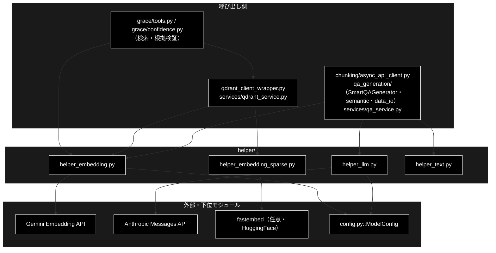

# README_helper.md - helper/ ディレクトリ概要

**Version 1.3** | 最終更新: 2026-10-11

`helper/` の入口となる文書。ディレクトリの役割・モジュール索引・組み合わせ方・import のしかた・既知の制約をまとめる。
文書を新しく書く／直す前に、まずここを見る。

> ⚠️ **本リポジトリは Anthropic 版。** 姉妹リポジトリ `grace_v2_local`（Ollama 版）にも同じ構成の `helper/` があるが、
> `helper_llm.py` は別物（local は Ollama クライアント・883 行）で、`helper_embedding_sparse.py`（キャッシュの場所をログに出す）も違う。文書をコピーで持ち込まないこと（CLAUDE.md §5）。

---

## 目次

- [概要](#概要)
  - [主な責務](#主な責務)
  - [各責務対応のモジュール](#各責務対応のモジュール)
  - [アーキテクチャ構成図](#アーキテクチャ構成図)
- [1. モジュール一覧（索引）](#1-モジュール一覧索引)
- [2. 使い方（代表的なワークフロー）](#2-使い方代表的なワークフロー)
- [3. 公開 API（import のしかた）](#3-公開-apiimport-のしかた)
- [4. 処理フロー・データフロー](#4-処理フローデータフロー)
- [5. 既知の制約・残課題](#5-既知の制約残課題)
- [6. 変更履歴](#6-変更履歴)

---

## 概要

`helper/` は、**外部 API のクライアントの抽象化**（LLM・Embedding・疎ベクトル）と、**テキスト・データの前処理の小さな部品**を集めたディレクトリである。
本番で効いているのは主に 3 つ:

- `helper_embedding.py` — Gemini Embedding（3072 次元）。検索クエリ・登録文書の埋め込み（`qdrant_client_wrapper.py` / `services/qdrant_service.py` 経由）と、根拠検証（`grace/confidence.py`）が使う
- `helper_embedding_sparse.py` — hybrid 検索の疎ベクトル（任意。`grace/tools.py` が検索の前に 1 回だけ作る）
- `helper_llm.py` — **データ準備側**（チャンク化・Q/A 生成）の LLM クライアント（Anthropic）。GRACE-Support / GRACE-Review の推論は `grace/llm_compat.py` を使い、ここは通らない

残る `helper_text.py` は、Q/A 生成の入力 CSV を整える `clean_text()` 1 関数だけのモジュールである。

> 📌 **2026-10-11 に、本番の呼び出し元が無かった `helper_rag.py` / `helper_rag_qa.py` / `helper_embedding_fastembed.py` と、
> `helper_text.py` の `clean_text` 以外の関数を削除した**（実装は git 履歴に残る。文書は [`archive/`](archive/) に移した。§1）。

### 主な責務

- Embedding（密ベクトル）クライアントの抽象化と Gemini / OpenAI の実装
- hybrid 検索用の疎ベクトル（SPLADE）の生成と、失敗の記憶
- データ準備で使う LLM クライアントの抽象化と Anthropic / OpenAI / Gemini の実装
- 入力テキストのクレンジング

### 各責務対応のモジュール

| # | 責務 | 対応モジュール | 説明 |
|---|------|--------------|------|
| 1 | Embedding クライアント | `helper_embedding.py` | `create_embedding_client()` / `GeminiEmbedding` / `separate_contents()` |
| 2 | 疎ベクトル | `helper_embedding_sparse.py` | `get_sparse_embedding_client()`（negative cache 付き） |
| 3 | データ準備の LLM クライアント | `helper_llm.py` | `create_llm_client()` / `AnthropicClient`（`generate_structured`・`last_usage`） |
| 4 | 入力テキストのクレンジング | `helper_text.py` | `clean_text()` |

### アーキテクチャ構成図



**データフロー**:

1. 検索のたびに、クエリを `helper_embedding`（`retrieval_query`）で密ベクトルに、`helper_embedding_sparse` で疎ベクトルにする（疎ベクトルは失敗しても続ける）
2. 登録では、Q/A の文を `helper_embedding.embed_texts`（100 件ずつ・`retrieval_document`）で埋め込む。失敗したまとまりはゼロベクトルになる
3. データ準備では、チャンク化・Q/A 生成が `helper_llm.create_llm_client("anthropic")` の `generate_structured` で JSON を受け、Q/A 生成の入力 CSV は `clean_text` で整える

---

## 1. モジュール一覧（索引）

`helper/*.py` は 4 モジュール（`__init__.py` は無い。§3）。処理フロー・データフローの別文書は置かない（理由は §4）。

| モジュール | 文書 | 種別 | 行数 | Ver | 本番の呼び出し元 | 概要 |
|---|---|---|---:|---|---|---|
| `helper_embedding.py` | [`helper_embedding.md`](./helper_embedding.md) | E | 634 | 1.1 | `qdrant_client_wrapper` / `services/qdrant_service` / `grace/confidence` / `qa_generation/semantic` | Embedding クライアント（Gemini 既定） |
| `helper_embedding_sparse.py` | [`helper_embedding_sparse.md`](./helper_embedding_sparse.md) | E | 472 | 1.0 | `qdrant_client_wrapper`（← `grace/tools` / `agent_tools`） | 疎ベクトル（SPLADE・negative cache） |
| `helper_llm.py` | [`helper_llm.md`](./helper_llm.md) | E | 544 | 1.1 | `chunking/async_api_client` / `qa_generation/smart_qa_generator` / `qa_generation/semantic` / `services/qa_service` | データ準備の LLM クライアント（Anthropic 既定） |
| `helper_text.py` | [`helper_text.md`](./helper_text.md) | E | 219 | 2.0 | `qa_generation/data_io` | `clean_text()` だけ |
| ~~`helper_rag.py`~~ | [`archive/helper_rag.md`](./archive/helper_rag.md) | — | — | — | — | **2026-10-11 に削除**。`clean_text` の再エクスポート以外に呼び出し元が無く、import 時に `logging.basicConfig` を呼んでいた |
| ~~`helper_rag_qa.py`~~ | [`archive/helper_rag_qa.md`](./archive/helper_rag_qa.md) | — | — | — | — | **2026-10-11 に削除**。テスト以外に呼び出し元が無かった（後継は `qa_generation/`）。CI に `spacy` を入れていたのはこのファイルのため |
| ~~`helper_embedding_fastembed.py`~~ | [`archive/helper_embedding_fastembed.md`](./archive/helper_embedding_fastembed.md) | — | — | — | — | **2026-10-11 に削除**（`helper_embedding` の `provider="fastembed"` の分岐も）。本番では選ばれず、選ぶと検索クエリで `TypeError` になっていた |
| ~~`helper_api.py`~~ | — | — | — | — | — | **2026-10-11 に削除**。誰も import しておらず、中身（設定・キャッシュ・JSON・トークン）は `services/` に切り出し済みだった |
| ~~`helper_rag_ui.py`~~ | — | — | — | — | — | **2026-10-11 に削除**。削除済みの `ui/`（Streamlit）を import しており、読み込むだけでエラーになっていた |

> 行数は文書（`.md`）の行数、Ver は各文書の Version ヘッダーの実測値（2026-10-11。`services/docs/README_services.md` §1 と同じ数え方）。

**依存関係**（各 `.py` の import。2026-10-11 実測）:

| モジュール | `helper/` の中の依存先 | `helper/` の外の依存先 |
|---|---|---|
| `helper_embedding` | なし | `config`・`google-genai`・`openai`・`dotenv` |
| `helper_embedding_sparse` | なし | `fastembed`（任意）・`tqdm`（任意） |
| `helper_llm` | なし | `config`・`anthropic`（遅延）・`openai`・`google-genai`（遅延）・`tiktoken`・`pydantic`・`dotenv` |
| `helper_text` | なし | `re`・`pandas`（関数の中で import・任意） |

---

## 2. 使い方（代表的なワークフロー）

各モジュール単体の使い方は、それぞれの文書の **§4.1 使用例**（処理パターンごとの例）にある。ここには**モジュールを組み合わせる**流れだけを置く。

| 使い方 | 組み合わせ | 向いている場面 | 例 |
|---|---|---|---|
| Q/A を作って埋め込む | `helper_text.clean_text` → `helper_llm`（構造化出力）→ `helper_embedding.embed_texts` | データ準備（整形 → Q/A 生成 → 登録）の流れを 1 本のスクリプトで確かめる | 2.1 |
| 検索クエリの dense と sparse を作る | `qdrant_client_wrapper.embed_query`（`helper_embedding`）＋ `embed_sparse_query_unified`（`helper_embedding_sparse`） | 本番の検索（`grace/tools.py`）と同じ組み立て方 | 2.2 |
| import の副作用を知る | `helper_text` / `helper_embedding` / `helper_llm` を import する | ログや `.env` の読み込みがいつ起きるかを知る | 2.3 |

> 📝 2.1〜2.3 は**別プロセスでそのまま実行し**、出力を確かめてある（2026-10-11・リポジトリ直下で実行）。
> Anthropic（`anthropic.Anthropic`）・Gemini Embedding（`google.genai.Client`）・`fastembed` はスタブに差し替えたので、**Q/A の文・usage・疎ベクトルの個数はスタブの値**。
> 2.2 は `fastembed` のスタブ無し（この VM の実際の状態）でも動かし、dense だけに落ちることを確かめた。

### 2.1 Q/A を作って埋め込む（整形 → 構造化出力 → Embedding）

```python
from helper.helper_text import clean_text
from helper.helper_llm import create_llm_client
from helper.helper_embedding import create_embedding_client
from models import QAPairsList

cell = "  住民票の写しは\n市役所の窓口で取得できます。  手数料は1通300円です。 "
text = clean_text(cell)                                        # 1. 入力 CSV のセルを整える（qa_generation/data_io.py）
llm = create_llm_client("anthropic")                           # 2. Q/A を構造化出力で作る（SmartQAGenerator と同じ型）
qa = llm.generate_structured(f"次の文から Q/A を 2 つ作ってください。\n{text}", QAPairsList, max_output_tokens=1024)
emb = create_embedding_client("gemini")                        # 3. 質問を Embedding にする（登録は services/qdrant_service.py）
vecs = emb.embed_texts([p.question for p in qa.qa_pairs])
print(repr(text))
print([p.question for p in qa.qa_pairs], llm.last_usage)
print(len(vecs), len(vecs[0]))
```

```
# 出力例（Q/A の文と usage はスタブの値）:
# '住民票の写しは 市役所の窓口で取得できます。 手数料は1通300円です。'
# ['住民票の写しはどこで取得できますか？', '住民票の写しの手数料はいくらですか？'] {'input_tokens': 500, 'output_tokens': 80}
# 2 3072
```

> 📝 本番では 2. を `qa_generation.QAPipeline` → `SmartQAGenerator`、3. を `services/qdrant_service.py` の登録関数（Q と A をつないだ文を埋め込む）が行う。
> ここでは `helper/` の 3 モジュールの役割が見えるよう、直接つないだ。

### 2.2 検索クエリの dense と sparse を作る（本番の検索と同じ）

```python
from qdrant_client_wrapper import embed_query, embed_sparse_query_unified

query = "住民票の写しはどこで取れますか"
dense = embed_query(query)                                     # helper_embedding（Gemini・retrieval_query）
try:
    sparse = embed_sparse_query_unified(query)                 # helper_embedding_sparse（FastEmbed。任意）
except Exception as e:                                         # grace/tools.py と同じく、失敗したら dense だけで検索する
    sparse = None
    print("sparse なし:", type(e).__name__)
print(len(dense), None if sparse is None else len(sparse.indices))
```

```
# 出力例（fastembed がある環境。疎ベクトルの個数はスタブの値）:
# 3072 14
# 出力例（fastembed が無い環境。CI・この VM）:
# sparse なし: ImportError
# 3072 None
# （標準エラーに 1 回だけ「Sparse Embedding の初期化に失敗しました … dense 検索のみで動作します」）
```

### 2.3 import の副作用を知る

```python
import logging
import sys

root = logging.getLogger()
print(root.level, len(root.handlers))
import helper.helper_text   # noqa: E402  副作用なし（re だけ）
print(root.level, len(root.handlers), "services" in sys.modules)
import qa_generation        # noqa: E402  smart_qa_generator.py が logging.basicConfig(level=INFO) を呼ぶ
print(root.level, len(root.handlers))
```

```
# 出力例:
# 30 0
# 30 0 False
# 20 1
```

> 📌 `helper_text` の import は何も起こさない。2026-10-11 までは `helper_text` / `helper_rag` が `services` を import し、`services/config_service.py` が
> カレントの `config.yml` を読んで（無ければ「設定ファイルが見つかりません: config.yml」）、`helper_rag` がルートロガーを INFO にしていた（両方とも削除した）。
> `qa_generation` を import するとルートロガーが INFO・ハンドラ 1 つになるのは、`qa_generation/smart_qa_generator.py` の `logging.basicConfig` による（`helper/` ではない）。
> `helper_embedding` / `helper_llm` は import 時に `load_dotenv()` でカレントの `.env` を読む。

---

## 3. 公開 API（import のしかた）

`helper/` に **`__init__.py` は無い**（名前空間パッケージ）。`from helper.helper_xxx import ...` とモジュール名まで書いて import する。
`from helper import X` で取れる名前は無い。

> ⚠️ **パッケージ名を付けない裸 import（`from helper_llm import ...`）を書かない。** `helper/` が `sys.path` に入っているとき（`celery_tasks` を先に読んだとき）だけ
> 解決するため、環境によって動いたり動かなかったりする。`tests/test_qa_generation_import_side_effects.py` が `helper/*.py` を `ast` で走査して検査している。

各モジュールの公開名は、それぞれの文書の「エクスポート」節にある。`__all__` を持つモジュールは無い。

---

## 4. 処理フロー・データフロー

**別文書（`helper_process_flow.md` / `helper_data_flow.md`）は置かない。** `helper/` のモジュールは、Embedding・LLM・テキストの部品として
**1 回の呼び出しで完結する**ものが多く、3 モジュール以上をまたぐ多段の処理は呼び出し側（`qdrant_client_wrapper.py`・`qa_generation/`・`grace/`）にあるため
（`a_cross_doc_md_format.md` §1.3）。モジュールをまたぐ処理の流れは各領域の文書を見る:

| 流れ | 文書 |
|---|---|
| 検索（dense＋sparse・hybrid） | `grace/docs/tools.md`・`grace/docs/grace_process_flow.md` |
| 登録（Q/A CSV → Embedding → Qdrant） | `services/docs/qdrant_service.md`・`backend/docs/data_pipeline.md` |
| チャンク化・Q/A 生成 | `chunking/docs/README_chunking.md`・`qa_generation/docs/README_qa_generation.md` |

読み書きするファイル・外部 API:

| 対象 | 場所 | モジュール | 読む／書く |
|---|---|---|---|
| Gemini Embedding API | `GOOGLE_API_KEY` / `GEMINI_API_KEY` | `helper_embedding` | 呼ぶ |
| Anthropic Messages API | `ANTHROPIC_API_KEY` | `helper_llm` | 呼ぶ |
| FastEmbed のモデル | HuggingFace → `FASTEMBED_CACHE_PATH`（既定 `<tempdir>/fastembed_cache`） | `helper_embedding_sparse` | 初回に取得 |
| tiktoken の符号表 | `openaipublic.blob.core.windows.net` → tiktoken のキャッシュ | `helper_llm`（`count_tokens`） | 初回に取得 |
| `.env` | カレント | `helper_embedding` / `helper_llm` | 読む |

---

## 5. 既知の制約・残課題

2026-10-11 に 7 モジュールの文書を書き、使用例を動かす中で確かめた制約（詳細は各文書の §5）。同日、未使用の 3 モジュールを削除した。

| # | 制約 | 状態 |
|---|---|---|
| 1 | `helper_embedding.GeminiEmbedding.embed_texts` は API エラー・件数の合わない応答をゼロベクトルで埋め、例外を出さない。登録は成功したように見え、そのテキストは検索で当たらない | 並びを保つための設計（`helper_embedding.md` §4.1.3） |
| 2 | `helper_llm.AnthropicClient` は `stop_reason` を見ない（拒否は空文字、打ち切りは構造化出力の `ValidationError`）。`grace/llm_compat.py` と扱いが違う | 未対応（`helper_llm.md` §5.3） |
| 3 | `helper_llm.AnthropicClient` の既定モデルは文字列の直書きで、`ModelConfig.DEFAULT_MODEL` を参照していない（`default_model` を渡さない `services/qa_service.py` が既定の変更に追随しない） | 2026-10-11 時点で値は同じ。CLAUDE.md §3.1 の経路 3 の取り残しになりうる |
| 4 | ~~`helper_embedding_fastembed.FastEmbedEmbedding.embed_text` が `task_type` を受け取らず、`EMBEDDING_PROVIDER=fastembed` では検索クエリの埋め込みが `TypeError`~~ | **2026-10-11 に解消**（モジュールと分岐を削除） |
| 5 | `helper_text.clean_text` の「引用符の正規化」は何もしていない（全角の引用符が失われ、2 行目は三重引用符として読まれている） | 呼び出し元は当てにしていない（`helper_text.md` §5） |
| 6 | ~~`helper_rag_qa.QAGenerationConsiderations.analyze_document_characteristics` は定義されていないメソッドを 7 つ呼び、必ず `AttributeError`~~ | **2026-10-11 に解消**（`helper_rag_qa.py` を削除） |
| 7 | ~~`helper_rag` は import 時に `logging.basicConfig(level=INFO)` を呼ぶ~~ | **2026-10-11 に解消**（`helper_rag.py` を削除。§2.3） |
| 8 | ~~`helper_text`（`clean_text` 以外）・`helper_rag`・`helper_rag_qa`・`helper_embedding_fastembed` は本番の呼び出し元が無い~~ | **2026-10-11 に削除**（`helper_api.py` / `helper_rag_ui.py` も同日に削除済み） |

### 5.1 文書を保守するときの約束とテスト件数

- `helper/*.py` を足したら、`<module>.md` を `a_class_method_md_format.md` で書き、§1 の表に行を足す。
- 使用例（各文書の §4.1）は**動かして確かめる**。外部 API・fastembed はスタブでよいが、スタブの値であることを出力例に書く。
- 姉妹リポジトリの文書をコピーしない（本文の冒頭の注記）。

関連するテスト（2026-10-11 に `PYTHONPATH=. .venv/bin/python -m pytest <file> -q` で実測）:

| テスト | 件数 | 対象 |
|---|---:|---|
| `tests/test_gemini_embedding_batch.py` | 3 | `helper_embedding`（1 件 = 1 Content・件数の合わない応答のゼロ埋め） |
| `tests/test_embedding_model_single_source.py` | 5 | Embedding のモデル名・単価の定義が `ModelConfig` の 1 箇所（`helper_embedding` / `helper_llm` を含む） |
| `tests/test_silent_failures.py` | 15（うち 5） | `TestSparseInitFailureIsRemembered`（`helper_embedding_sparse` の negative cache） |
| `tests/test_levers.py` | 67（うち 13） | `test_helper_client_*`（`helper_llm.AnthropicClient` の `temperature` / `thinking` の送り分け） |
| `tests/test_llm_provider_validation.py` | 15（うち 8） | `test_create_llm_client_*`（`helper_llm.create_llm_client` の未知のプロバイダ） |
| `tests/test_haiku_5_5_defaults.py` | 12（うち 2） | `helper_llm.LLM_PRICING` / `LLM_LIMITS` に Haiku 5.5 の行がある |
| `tests/test_qa_generation_import_side_effects.py` | 3（うち 1） | `helper/*.py` に裸 import が無い |

`helper_text.py` を直接検査するテストは無い（`helper_rag_qa.py` を検査していた `tests/test_hybrid_qa_generator.py` は 2026-10-11 にモジュールとともに削除）。

---

## 6. 変更履歴

| バージョン | 日付 | 変更内容 |
|---|---|---|
| 1.0 | 2026-10-11 | 初版。`helper/docs/` を新設し、7 モジュールの文書（`a_class_method_md_format.md`）と本 README（`a_cross_doc_md_format.md` §1.2）を作成した。未使用だった `helper_api.py`（誰も import していない）と `helper_rag_ui.py`（削除済みの `ui/` を import し、読み込めない）を削除した。各文書の §4.1 使用例と本 README の §2 を別プロセスで実行して出力を確かめ（外部 API・spaCy・fastembed はスタブ）、見つかった制約を §5 にまとめた |
| 1.1 | 2026-10-11 | `chunking/docs/` の構成整理（`README.md` → `README_chunking.md`）に合わせてリンクを直した |
| 1.2 | 2026-10-11 | 本番の呼び出し元が無かった `helper_rag.py` / `helper_rag_qa.py` / `helper_embedding_fastembed.py` と `helper_text.py` の `clean_text` 以外の関数を削除したのに追随。3 モジュールの文書を `archive/` へ移し、§1 の索引・依存関係・§2.3（import の副作用が無くなった）・§4・§5・§5.1 を更新した。§2 を実行し直して出力を確かめた |
| 1.3 | 2026-10-11 | `qa_generation/docs/` の構成整理（`README.md` → `README_qa_generation.md`、`__init__.md` を統合、`make_qa_qapipeline.md` → `qa_generation_process_flow.md`）に合わせてリンクを直した |
