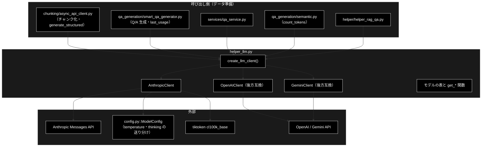
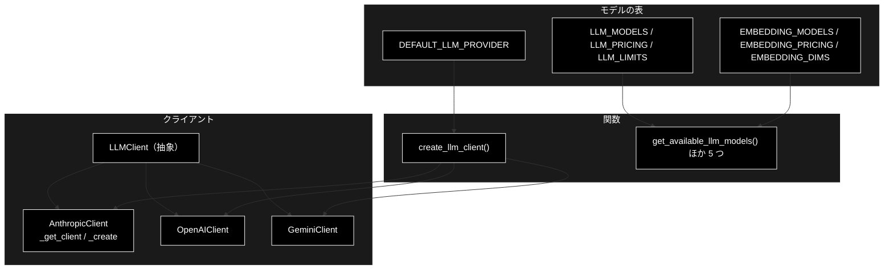
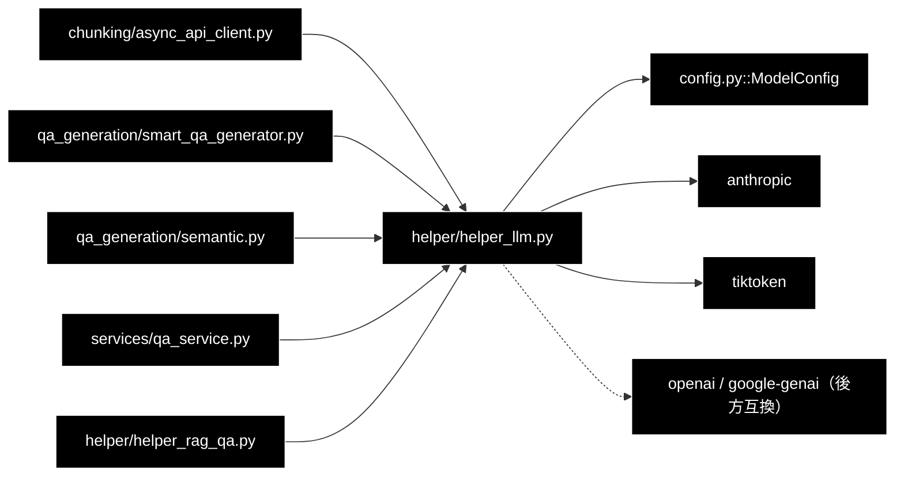

# helper_llm.py - LLM クライアント抽象化レイヤー ドキュメント

**Version 1.0** | 最終更新: 2026-10-11

---

## 目次

1. [概要](#概要)
2. [アーキテクチャ構成図](#1-アーキテクチャ構成図)
3. [モジュール構成図](#2-モジュール構成図)
4. [クラス・関数一覧表](#3-クラス関数一覧表)
5. [クラス・関数 IPO詳細](#4-クラス関数-ipo詳細)
6. [設定・定数](#5-設定定数)
7. [エクスポート](#6-エクスポート)
8. [変更履歴](#7-変更履歴)
9. [付録: 依存関係図](#付録-依存関係図)

---

## 概要

`helper_llm.py` は、**データ準備（チャンク化・Q/A 生成）側**が使う LLM クライアントの抽象化レイヤーである。
抽象基底クラス `LLMClient`（テキスト生成・構造化出力・トークン数）と、Anthropic（既定）/ OpenAI / Gemini の実装、
プロバイダ名から実装を選ぶ `create_llm_client()`、モデルの一覧・単価・上限の表を持つ。

> 📌 **GRACE-Support / GRACE-Review の推論は本モジュールを使わない。** エージェント側（planner / executor / 根拠検証 など）の LLM は
> `grace/llm_compat.py::create_chat_client`（`stop_reason` の検査・思考の扱いなどを持つ別の実装）である。
> 本モジュールを使うのはチャンク化（`chunking/async_api_client.py`）・Q/A 生成（`qa_generation/smart_qa_generator.py`）・
> `services/qa_service.py`・`qa_generation/semantic.py`（トークン数だけ）・`helper_rag_qa.py`。
> Tool Use（`generate_with_tools` / `build_tool_result_message`）は唯一の呼び出し元だった Legacy ReAct とともに 2026-10-10 に削除した。

### 主な責務

- LLM クライアントの共通インターフェース（テキスト生成・構造化出力・トークン数）の定義
- Anthropic Messages API の呼び出し（モデル世代ごとの `temperature` / `thinking` の送り分け・使用トークン数の記録）
- 構造化出力（JSON Schema をシステムプロンプトに入れ、応答を pydantic で検証）
- OpenAI / Gemini の呼び出し（後方互換）
- プロバイダ名からのクライアント生成（未知の名前は `ValueError`）
- LLM・Embedding モデルの一覧・単価・上限・次元の表

### 各責務対応のモジュール

| # | 責務 | 対応モジュール | 説明 |
|---|------|--------------|------|
| 1 | 共通インターフェース | `helper_llm.py` | `LLMClient`（`generate_content` / `generate_structured` / `count_tokens`） |
| 2 | Anthropic の呼び出し | `helper_llm.py`（送り分けの表は `config.py::ModelConfig`） | `AnthropicClient._create()`・`last_usage` |
| 3 | 構造化出力 | `helper_llm.py` | `AnthropicClient.generate_structured()` / `OpenAIClient` / `GeminiClient` の同名メソッド |
| 4 | OpenAI / Gemini（後方互換） | `helper_llm.py` | `OpenAIClient` / `GeminiClient` |
| 5 | クライアント生成 | `helper_llm.py` | `create_llm_client()` |
| 6 | モデルの表 | `helper_llm.py`（Embedding の定義は `config.py::ModelConfig`） | `LLM_MODELS` / `LLM_PRICING` / `LLM_LIMITS` / `EMBEDDING_*` と `get_*` 関数 6 つ |

### 主要機能一覧

| 機能 | 説明 |
|------|------|
| `create_llm_client(provider=None, **kwargs)` | `anthropic`（既定）/ `openai` / `gemini`（`google`）。未知の名前は `ValueError` |
| `AnthropicClient.generate_content(prompt, model=None, **kwargs)` | テキストを返す。`max_tokens` / `max_output_tokens` / `temperature` を受ける |
| `AnthropicClient.generate_structured(prompt, response_schema, model=None, **kwargs)` | pydantic のインスタンスを返す（コードフェンスを外してから検証） |
| `AnthropicClient.last_usage` | 直近 1 回の `input_tokens` / `output_tokens` |
| `count_tokens(text, model=None)` | Anthropic は tiktoken `cl100k_base` による**近似** |
| `get_llm_model_pricing` / `get_llm_model_limits` | 1K トークンあたりの USD・入出力の上限（表に無ければ 0） |

---

## 1. アーキテクチャ構成図

### 1.1 システム全体構成



### 1.2 データフロー

1. 呼び出し側が `create_llm_client("anthropic", default_model=...)` でクライアントを作る（作っただけでは SDK を読み込まず通信もしない）
2. `generate_structured` は JSON Schema をシステムプロンプトに入れて `_create` を呼ぶ
3. `_create` は `ModelConfig` の表を見て、`temperature` を送るか・`thinking: {"type": "disabled"}` を送るかを決め、`messages.create` を呼ぶ
4. 応答の `usage` を `last_usage` に記録し、テキストのブロックをつないで返す。構造化出力はコードフェンスを外して `{ ... }` を切り出し、`model_validate_json` で検証する

---

## 2. モジュール構成図

### 2.1 内部モジュール構成



### 2.2 外部依存関係

| ライブラリ | バージョン | 用途 |
|-----------|-----------|------|
| `anthropic` | `requirements-test.txt` 参照 | `AnthropicClient`（最初の API 呼び出しで遅延 import） |
| `openai` | 同上 | `OpenAIClient`（import に失敗しても `OpenAI = None` で続ける） |
| `google-genai` | 同上 | `GeminiClient`（`__init__` で遅延 import） |
| `tiktoken` | 同上 | `count_tokens`（Anthropic / OpenAI） |
| `pydantic` | 同上 | 構造化出力の型と検証 |
| `python-dotenv` | 同上 | import 時に `load_dotenv()` |

### 2.3 内部依存モジュール

| モジュール | 用途 |
|-----------|------|
| `config.py::ModelConfig` | `supports_temperature` / `uses_adaptive_thinking` / `thinking_always_on`（モデル世代の送り分け）・`EMBEDDING_*` |

---

## 3. クラス・関数一覧表

### 3.1 クラス一覧

#### LLMClient（抽象基底クラス）

| メソッド | 概要 |
|---------|------|
| `generate_content(prompt, model=None, **kwargs)` | テキスト |
| `generate_structured(prompt, response_schema, model=None, **kwargs)` | pydantic のインスタンス |
| `count_tokens(text, model=None)` | トークン数 |

#### AnthropicClient（既定）

| メンバー | 概要 |
|---------|------|
| `__init__(api_key=None, default_model="claude-sonnet-5-5")` | キーとモデルを覚えるだけ（SDK の読み込みは遅延） |
| `last_usage` | 直近 1 回の `{"input_tokens", "output_tokens"}` |
| `_get_client()` | `anthropic.Anthropic` を初回だけ作る |
| `_create(prompt, model, system=None, **kwargs)` | `messages.create` の組み立てと呼び出し |
| `generate_content(prompt, model=None, **kwargs)` | `_create` の結果 |
| `generate_structured(prompt, response_schema, model=None, **kwargs)` | JSON Schema つきで `_create` → 検証 |
| `count_tokens(text, model=None)` | `cl100k_base` による近似 |

#### OpenAIClient / GeminiClient（後方互換）

| クラス | 既定モデル | 構造化出力 | トークン数 |
|-------|-----------|-----------|-----------|
| `OpenAIClient(api_key=None, default_model="gpt-4o-mini")` | `gpt-4o-mini` | `beta.chat.completions.parse(response_format=...)` | `tiktoken.encoding_for_model`（無ければ `cl100k_base`） |
| `GeminiClient(api_key=None, default_model="gemini-2.5-flash")` | `gemini-2.5-flash` | `response_mime_type="application/json"`＋`response_schema` | `models.count_tokens`（API を呼ぶ） |

### 3.2 関数一覧（カテゴリ別）

| 関数名 | 概要 |
|-------|------|
| `create_llm_client(provider=None, **kwargs)` | プロバイダ名からクライアントを作る |
| `get_available_llm_models()` | `LLM_MODELS`（14 件） |
| `get_llm_model_pricing(model_name)` | `{"input", "output"}`（1K トークンあたりの USD） |
| `get_llm_model_limits(model_name)` | `{"max_tokens", "max_output"}` |
| `get_available_embedding_models()` | `EMBEDDING_MODELS`（3 件） |
| `get_embedding_model_pricing(model_name)` | 1K トークンあたりの USD |
| `get_embedding_model_dimensions(model_name)` | 次元（表に無ければ 0） |

---

## 4. クラス・関数 IPO詳細

### 4.1 使用例

| 処理パターン | 呼び方 | 向いている場面 | 例 |
|---|---|---|---|
| テキストを生成する | `create_llm_client()` → `generate_content` → `last_usage` | 1 回の生成とトークン数の記録（`services/qa_service.py`） | 4.1.1 |
| 構造化出力（本番の主な使い方） | `create_llm_client("anthropic", default_model=...)` → `generate_structured(prompt, Model)` | チャンク化（`chunking/async_api_client.py`）・Q/A 生成（`qa_generation/smart_qa_generator.py`） | 4.1.2 |
| 送る内容を確かめる | `_client` を差し替えて `messages.create` の引数を見る | モデルを変えたときに `temperature` / `thinking` がどう送られるか | 4.1.3 |
| 表を引く・プロバイダを間違える | `get_llm_model_pricing` / `get_llm_model_limits` / `create_llm_client("anthropc")` | 費用の見積もり・設定の打ち間違い | 4.1.4 |

> 📝 4 本とも**別プロセスでそのまま実行し**、出力を確かめてある（2026-10-11・リポジトリ直下で実行）。
> 4.1.1 / 4.1.2 は `anthropic.Anthropic` をスタブ（固定の文と、コードフェンス付きの JSON を返す）に差し替えたので、**生成された文はスタブのもの**。
> 4.1.3 は例の中で `_client` を差し替えるので API を呼ばない。4.1.4 は API を呼ばない。トークン数は本物の `cl100k_base` の値。

#### 4.1.1 基本的なワークフロー（テキストを生成する）

```python
from helper.helper_llm import create_llm_client

llm = create_llm_client()                    # 既定は環境変数 LLM_PROVIDER、無ければ anthropic（ANTHROPIC_API_KEY が要る）
print(type(llm).__name__, llm.default_model)
text = llm.generate_content("住民票の写しはどこで取れますか。1 文で。", max_output_tokens=200)
print(text)
print(llm.last_usage, llm.count_tokens(text))
```

```
# 出力例（文と usage はスタブの値）:
# AnthropicClient claude-sonnet-5-5
# 住民票の写しは市役所の窓口で取得できます。
# {'input_tokens': 42, 'output_tokens': 17} 23
```

> ⚠️ `count_tokens` は **tiktoken `cl100k_base`（OpenAI の符号表）による近似**で、Claude の実際のトークン数とは違う（実際の値は `last_usage`）。
> `last_usage` は**インスタンスに 1 つ**なので、同じクライアントを複数スレッドで使う（チャンク化の `asyncio.to_thread`）と、他の呼び出しの値で上書きされる。
> `max_output_tokens` を省くと 2048 になる。

#### 4.1.2 構造化出力（本番の主な使い方）

```python
from typing import List
from pydantic import BaseModel
from helper.helper_llm import create_llm_client


class Procedure(BaseModel):
    title: str
    steps: List[str]


llm = create_llm_client("anthropic", default_model="claude-haiku-5-5")   # chunking/async_api_client.py と同じ作り方
obj = llm.generate_structured("住民票の写しの取り方を手順にしてください。", Procedure, max_output_tokens=1024)
print(type(obj).__name__, obj.title, obj.steps)
```

```
# 出力例（内容はスタブの値。スタブは ```json のコードフェンス付きで返す）:
# Procedure 住民票の写しの取り方 ['窓口へ行く', '本人確認書類を出す']
```

> 📝 本番の入口は `chunking/async_api_client.py::AsyncAPIClient`（`generate_structured` を `asyncio.to_thread` で並列に呼ぶ）と
> `qa_generation/smart_qa_generator.py::SmartQAGenerator`（呼んだ直後に `last_usage` を取り込む）。
> ⚠️ **`stop_reason` を見ていない**（`grace/llm_compat.py` と違う）。`max_tokens` で JSON が途中で切れると `pydantic.ValidationError`、
> 拒否（`refusal`）で本文が空なら `generate_content` は空文字を返す。

#### 4.1.3 送る内容を確かめる（モデル世代の送り分け）

```python
from types import SimpleNamespace
from helper.helper_llm import AnthropicClient

sent = []
fake = SimpleNamespace(messages=SimpleNamespace(create=lambda **kw: sent.append(kw) or SimpleNamespace(content=[], usage=None)))
for model in ["claude-haiku-5-5", "claude-sonnet-5-5", "claude-haiku-4-5"]:
    llm = AnthropicClient(api_key="dummy", default_model=model)
    llm._client = fake                       # 送る内容だけを見る（API は呼ばない）
    llm.generate_content("こんにちは", temperature=0.2, max_output_tokens=300)
for kw in sent:
    print(kw["model"], kw["max_tokens"], kw.get("temperature"), kw.get("thinking"))
```

```
# 出力例:
# claude-haiku-5-5 300 None {'type': 'disabled'}
# claude-sonnet-5-5 300 None None
# claude-haiku-4-5 300 0.2 None
```

| モデル | `temperature` | `thinking` | 理由（`config.py::ModelConfig`） |
|---|---|---|---|
| `claude-haiku-5-5` | 送らない | `{"type": "disabled"}` | `NO_TEMPERATURE_MODELS`・`ADAPTIVE_THINKING_MODELS`（無効化できる。省くと思考が `max_tokens` を食う） |
| `claude-sonnet-5-5` / `claude-opus-5-5` / `claude-fable-5-1` | 送らない | 送らない | `ALWAYS_THINKING_MODELS`（`disabled` も 400 になる） |
| `claude-haiku-4-5` ほか旧世代 | 送る | 送らない | 表に無い |

> 📝 渡した `temperature` を黙って捨てるモデルがある（400 にならないよう）。モデルを選択肢に足すときは `ModelConfig` の 3 表を確かめる（CLAUDE.md §3.2）。

#### 4.1.4 表を引く・プロバイダを間違える

```python
from helper.helper_llm import (
    create_llm_client, get_available_llm_models, get_llm_model_limits, get_llm_model_pricing,
    get_embedding_model_dimensions,
)
print(len(get_available_llm_models()), get_available_llm_models()[:4])
print(get_llm_model_pricing("claude-sonnet-5-5"), get_llm_model_limits("claude-haiku-5-5"))
print(get_llm_model_pricing("gpt-5-mini"), get_llm_model_limits("gpt-5-mini"), get_embedding_model_dimensions("gemini-embedding-001"))
try:
    create_llm_client("anthropc")
except ValueError as e:
    print(e)
```

```
# 出力例:
# 14 ['claude-sonnet-5-5', 'claude-sonnet-5', 'claude-fable-5-1', 'claude-opus-5-5']
# {'input': 0.002, 'output': 0.01} {'max_tokens': 1000000, 'max_output': 128000}
# {'input': 0.0, 'output': 0.0} {'max_tokens': 0, 'max_output': 0} 3072
# 未知の LLM プロバイダです: 'anthropc'（anthropic / openai / gemini のいずれか。既定は環境変数 LLM_PROVIDER）
```

> ⚠️ **表に無いモデルは単価も上限も 0**（例外にはならない）。`gpt-5-mini` は実在するモデル名だが（CLAUDE.md R1）、本モジュールの表には無い。
> 単価・上限の正は `config.py::ModelConfig.MODEL_PRICING` / `MODEL_LIMITS` で、本モジュールの `LLM_PRICING` / `LLM_LIMITS` は**別の表**
> （Claude 9 モデルの値は同じ。2026-10-11 に突き合わせて確認。`tests/test_haiku_5_5_defaults.py` は Haiku 5.5 の行が両方の表にあることだけを検査し、値の一致は検査しない）。
> 未知のプロバイダ名は `ValueError`。2026-09-26 までは黙って `GeminiClient` にしていた（`tests/test_llm_provider_validation.py`）。

---

### 4.2 AnthropicClient クラス

**概要**: Anthropic Messages API のクライアント。作っただけでは SDK を読み込まず、最初の呼び出しで `anthropic.Anthropic` を作る。

#### メソッド: `__init__`

```python
def __init__(self, api_key: Optional[str] = None, default_model: str = "claude-sonnet-5-5")
```

| パラメータ | 型 | デフォルト | 説明 |
|------------|------|-----------|------|
| `api_key` | `Optional[str]` | `None` | 省略時は `ANTHROPIC_API_KEY`（無ければ SDK に任せる） |
| `default_model` | `str` | `"claude-sonnet-5-5"` | `model` を省いたときのモデル（文字列の直書き。§5.3） |

| 項目 | 内容 |
|------|------|
| **Input** | `api_key`・`default_model` |
| **Process** | キー・モデルを覚え、`_client = None`・`last_usage = {"input_tokens": 0, "output_tokens": 0}` |
| **Output** | インスタンス（通信しない・キーが無くても作れる） |

```python
# 使用例
from helper.helper_llm import AnthropicClient
print(AnthropicClient(api_key="dummy").last_usage)
# {'input_tokens': 0, 'output_tokens': 0}
```

#### メソッド: `_create`（内部）

| 項目 | 内容 |
|------|------|
| **Input** | `prompt`・`model`（`None` なら `default_model`）・`system`・`kwargs`（`max_tokens` / `max_output_tokens` / `temperature`） |
| **Process** | 1. `max_tokens` → `max_output_tokens` → 2048 の順で上限を決める<br>2. `temperature` は `ModelConfig.supports_temperature(model)` のときだけ送る<br>3. `uses_adaptive_thinking(model)` かつ `not thinking_always_on(model)` なら `thinking={"type": "disabled"}`<br>4. `messages.create(**kwargs)` を呼び、`usage` を `last_usage` に記録<br>5. `content` のブロックの `text` をつなぐ（`stop_reason` は見ない） |
| **Output** | `str`（本文。思考ブロックは `text` を持たないので入らない） |

> ⚠️ 上の 3 つ以外の `kwargs`（`top_p` など）は**黙って捨てる**（`messages.create` に渡らない）。

#### メソッド: `generate_content` / `generate_structured` / `count_tokens`

| メソッド | Input | Process | Output |
|---------|-------|---------|--------|
| `generate_content(prompt, model=None, **kwargs)` | プロンプトと上の `kwargs` | `_create(prompt, model, **kwargs)` | `str` |
| `generate_structured(prompt, response_schema, model=None, **kwargs)` | プロンプト・pydantic のクラス | 1. `model_json_schema()` を JSON にしてシステムプロンプトに入れる<br>2. `_create` の結果の前後を削り、` ``` ` で始まればフェンスを外す<br>3. 最初の `{` から最後の `}` までを切り出し `model_validate_json` | `BaseModel`（検証に失敗すると `ValidationError`） |
| `count_tokens(text, model=None)` | テキスト | `tiktoken.get_encoding("cl100k_base")` で数える（`model` は使わない） | `int`（近似） |

**戻り値例**:

```python
Procedure(title='住民票の写しの取り方', steps=['窓口へ行く', '本人確認書類を出す'])
```

```python
# 使用例は §4.1.1・§4.1.2
```

---

### 4.3 OpenAIClient / GeminiClient クラス（後方互換）

本番では使わない（LLM は Anthropic。CLAUDE.md §3）。`create_llm_client("openai")` / `create_llm_client("gemini")` で作る。

| メソッド | `OpenAIClient` | `GeminiClient` |
|---------|---------------|----------------|
| `__init__` | `OPENAI_API_KEY` が無ければ `ValueError`、`openai` が無ければ `ImportError` | `GOOGLE_API_KEY` / `GEMINI_API_KEY` が無ければ `ValueError`。`google.genai` は `__init__` で import |
| `generate_content` | `chat.completions.create(messages=[user], **kwargs)` | `models.generate_content`（自動関数呼び出しは常に無効。`temperature` / `max_output_tokens` だけ設定へ移す） |
| `generate_structured` | `beta.chat.completions.parse(response_format=schema)` の `parsed` | スキーマをプロンプトにも足し、`response_mime_type="application/json"` で受けて検証（失敗時は生の応答をログに出して送出） |
| `count_tokens` | `tiktoken.encoding_for_model`（無ければ `cl100k_base`） | `models.count_tokens`（**API を呼ぶ**） |

```python
# 使用例（キーが無いとき）
from helper.helper_llm import create_llm_client
try:
    create_llm_client("openai")
except ValueError as e:
    print(e)
# OPENAI_API_KEY is not set
```

---

### 4.4 関数

#### `create_llm_client`

```python
def create_llm_client(provider: str = None, **kwargs) -> LLMClient
```

| パラメータ | 型 | デフォルト | 説明 |
|------------|------|-----------|------|
| `provider` | `str` | `None` | `anthropic` / `openai` / `gemini`（`google` も可）。`None` は `DEFAULT_LLM_PROVIDER`。大文字小文字は区別しない |
| `**kwargs` | — | — | 実装クラスの `__init__` に渡す（`api_key` / `default_model`） |

| 項目 | 内容 |
|------|------|
| **Input** | `provider`・`kwargs` |
| **Process** | 名前で分岐し、どれにも当たらなければ `ValueError` |
| **Output** | `LLMClient` |

```python
# 使用例は §4.1.1・§4.1.2・§4.1.4
```

#### 表を引く関数

| 関数 | Input | Output（表に無いとき） |
|------|-------|----------------------|
| `get_available_llm_models()` | なし | `LLM_MODELS`（同じリストオブジェクト。書き換えると表も変わる） |
| `get_llm_model_pricing(model_name)` | モデル名 | `{"input", "output"}`（`{0.0, 0.0}`） |
| `get_llm_model_limits(model_name)` | モデル名 | `{"max_tokens", "max_output"}`（`{0, 0}`） |
| `get_available_embedding_models()` | なし | `EMBEDDING_MODELS` |
| `get_embedding_model_pricing(model_name)` | モデル名 | `float`（`0.0`） |
| `get_embedding_model_dimensions(model_name)` | モデル名 | `int`（`0`） |

```python
# 使用例
from helper.helper_llm import get_available_embedding_models, get_embedding_model_pricing
print(get_available_embedding_models(), get_embedding_model_pricing("gemini-embedding-001"))
# ['gemini-embedding-001', 'text-embedding-3-small', 'text-embedding-3-large'] 0.0001
```

---

## 5. 設定・定数

### 5.1 モデルの表

| 定数 | 中身 |
|------|------|
| `LLM_MODELS` | Claude 9 件（`claude-sonnet-5-5` が先頭）＋ Gemini 5 件（後方互換） |
| `LLM_PRICING` | 上の 14 件の `{"input", "output"}`（1K トークンあたりの USD・概算） |
| `LLM_LIMITS` | 上の 14 件の `{"max_tokens", "max_output"}` |
| `EMBEDDING_MODELS` | `ModelConfig.EMBEDDING_MODEL`・`text-embedding-3-small`・`text-embedding-3-large` |
| `EMBEDDING_PRICING` | `ModelConfig.EMBEDDING_PRICING`（同じ辞書） |
| `EMBEDDING_DIMS` | 上の 3 件の次元 |
| `DEFAULT_LLM_PROVIDER` | 環境変数 `LLM_PROVIDER`、無ければ `"anthropic"` |

### 5.2 環境変数

| 変数 | 用途 |
|------|------|
| `ANTHROPIC_API_KEY` / `ANTHROPIC_BASE_URL` | `AnthropicClient`（`BASE_URL` は SDK が読む） |
| `LLM_PROVIDER` | `create_llm_client()` の既定プロバイダ |
| `OPENAI_API_KEY` / `GOOGLE_API_KEY` / `GEMINI_API_KEY` | 後方互換のクライアント |

### 5.3 既知の制約

| # | 制約 | 状態 |
|---|------|------|
| 1 | `AnthropicClient` は `stop_reason` を見ない。拒否は空文字、`max_tokens` での打ち切りは構造化出力の `ValidationError` になる（`grace/llm_compat.py` は `LLMRefusalError` / `LLMTruncatedError` にする） | 未対応（2026-10-11 に確認） |
| 2 | `AnthropicClient` の既定 `default_model` は文字列の直書きで、`ModelConfig.DEFAULT_MODEL` を参照していない。`default_model` を渡さない呼び出し元（`services/qa_service.py`）は、`DEFAULT_MODEL` を変えても追随しない | 2026-10-11 時点で値は同じ（`claude-sonnet-5-5`）。CLAUDE.md §3.1 の経路 3 の取り残しになりうる |
| 3 | `count_tokens` は OpenAI の符号表による近似 | 実装どおり |
| 4 | `last_usage` はインスタンスに 1 つで、並列呼び出しでは上書きし合う | 実装どおり（§4.1.1） |
| 5 | `LLM_PRICING` / `LLM_LIMITS` は `config.py::ModelConfig` と別の表で、値の一致を検査するテストは無い | 2026-10-11 時点で Claude 9 モデルは一致（§4.1.4） |

---

## 6. エクスポート

`__all__` は定義していない。外から使われている名前は `create_llm_client`（データ準備の 5 モジュール）と、テストが参照する `AnthropicClient` / `GeminiClient` / `LLM_PRICING` / `LLM_LIMITS`。

---

## 7. 変更履歴

| バージョン | 日付 | 変更内容 |
|-----------|------|---------|
| 1.0 | 2026-10-11 | 初版。`helper/docs/` の新設にあわせて作成（`a_class_method_md_format.md` 準拠）。§4.1 の使用例 4 本（テキスト生成・構造化出力・送る内容の確認・表とプロバイダ名）を別プロセスで実行して出力を確かめ（Anthropic API はスタブ）、`stop_reason` を見ないこと・既定モデルの直書きを §5.3 に記録した |

---

## 付録: 依存関係図


