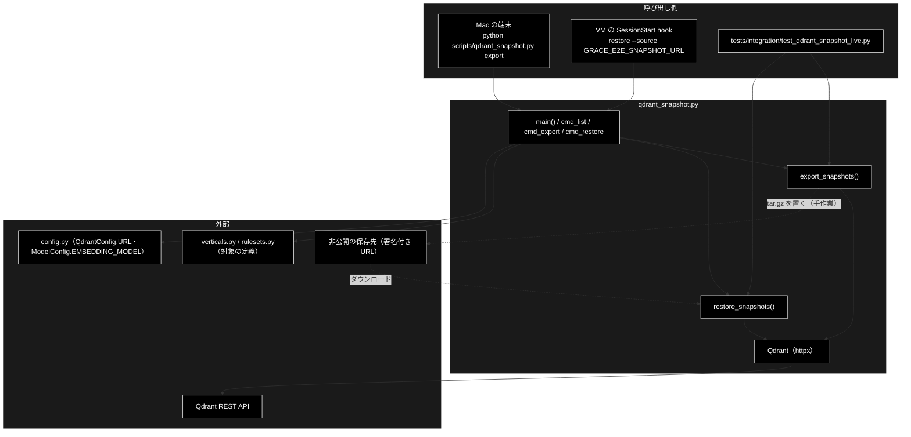
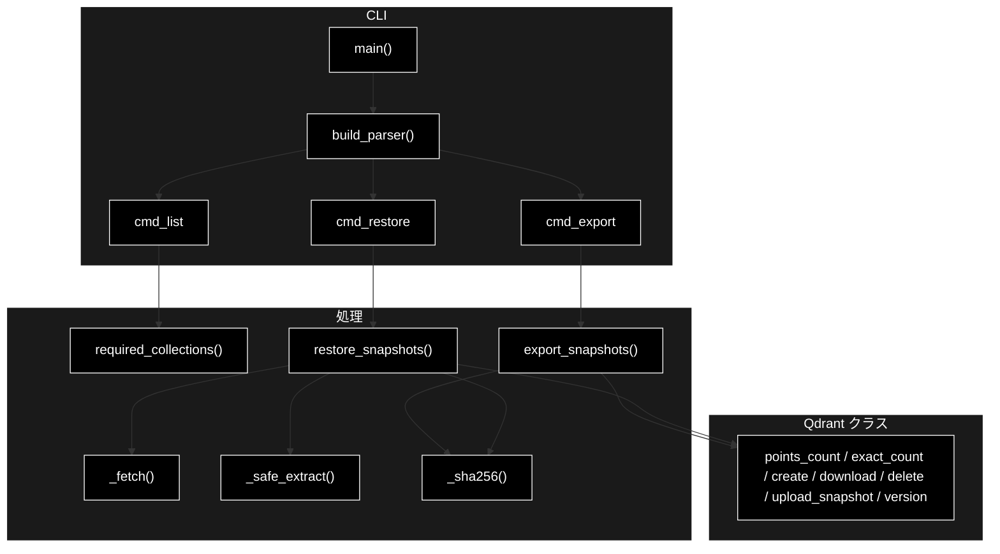
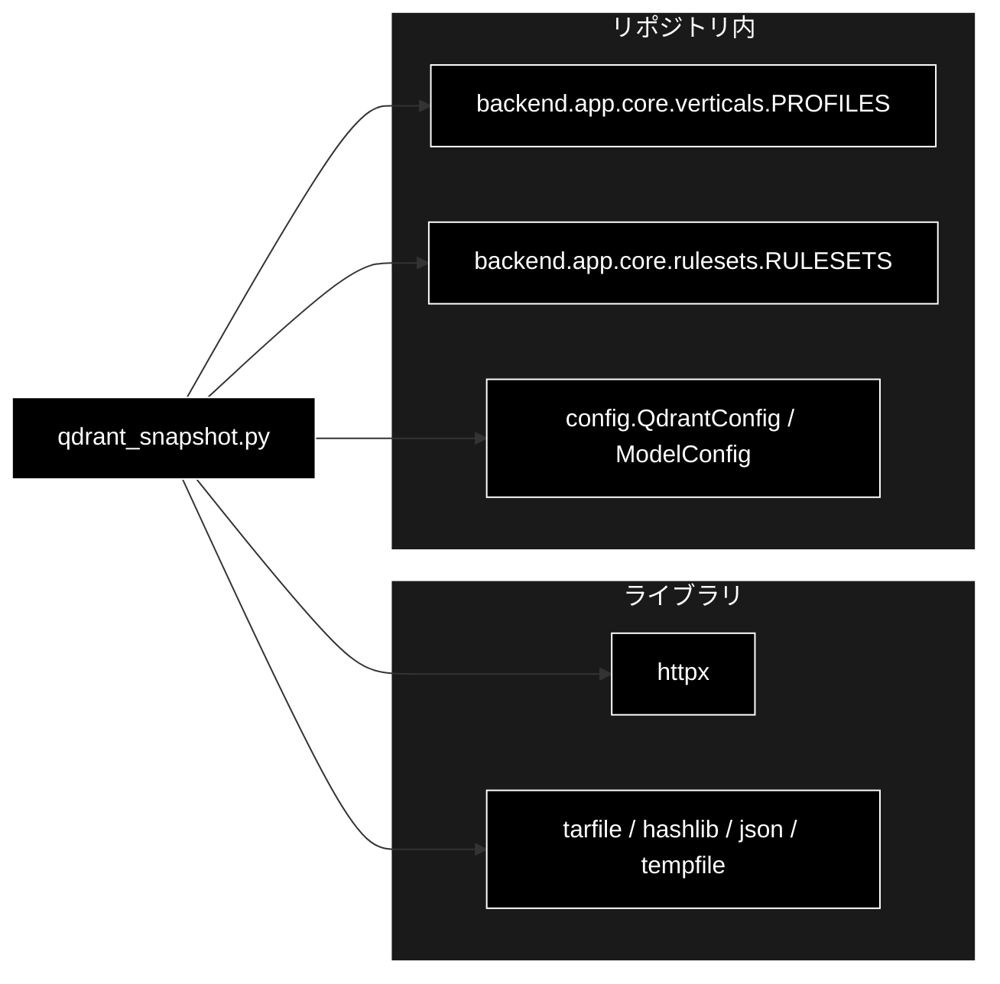

# qdrant_snapshot.py - E2E 用 Qdrant スナップショットの書き出し・復元 ドキュメント

**Version 1.1** | 最終更新: 2026-10-12

---

## 目次

1. [概要](#概要)
2. [アーキテクチャ構成図](#1-アーキテクチャ構成図)
3. [モジュール構成図](#2-モジュール構成図)
4. [クラス・関数一覧表](#3-クラス関数一覧表)
5. [クラス・関数 IPO詳細](#4-クラス関数-ipo詳細)
6. [設定・定数](#5-設定定数)
7. [エクスポート](#6-エクスポート)
8. [変更履歴](#7-変更履歴)
9. [付録: 依存関係図](#付録-依存関係図)

---

## 概要

`scripts/qdrant_snapshot.py` は、Mac の Qdrant にある**実データのコレクション**をスナップショット（ベクトル込みの丸ごとの複製）で 1 つの
`tar.gz` にまとめ（`export`）、クラウド VM（Claude Code on the web）の Qdrant へ戻す（`restore`）CLI です。
E2E（`tests/e2e/`）は実データを検索して初めて意味を持つが、Support 用データの元 CSV はリポジトリに無く、VM の Qdrant は空なので、
Embedding をやり直さずに**Mac と同じベクトル**を運ぶために使います。

> 📌 VM では、クラウド環境の設定で `GRACE_E2E_SNAPSHOT_URL`（署名付き URL）を入れておくと、SessionStart hook（`.claude/hooks/session-start.sh`）が
> 自動で `restore` する。手順の全体は [`docs/testing.md`](../../docs/testing.md) §1.2 と CLAUDE.md §2「E2E」。
> grace_v2_local には置かない（Qdrant は共用なので、スナップショットは grace_v2 からだけ作る）。

### 主な責務

- アプリが検索するコレクション名を、業界プロファイルとルールセットの定義から集める
- コレクションの点数を表示する（`list`）
- スナップショットを作ってダウンロードし、manifest（Embedding モデル・点数・sha256）とともに `tar.gz` にまとめる（`export`）
- `tar.gz` を検査して Qdrant へ復元する（`restore`。既存を上書きしない・モデル違いを拒否・点数を照合）

### 各責務対応のモジュール

| # | 責務 | 対応モジュール | 説明 |
|---|------|--------------|------|
| 1 | 対象コレクションの収集 | `qdrant_snapshot.py` ＋ `backend/app/core/verticals.py` / `rulesets.py` | `required_collections()` が `PROFILES[*].collections`・`RULESETS[*].collections`・`RuleItem.evidence_collections` の和集合を定義順・重複なしで返す（名前を書き写さない） |
| 2 | 点数の表示 | `qdrant_snapshot.py` | `cmd_list()` → `Qdrant.points_count()`。無いコレクションは `（無し）` |
| 3 | 書き出し | `qdrant_snapshot.py` | `export_snapshots()`: 作成 → ダウンロード → Qdrant 側のスナップショットを削除 → `manifest.json` と `<名前>.snapshot` を `tar.gz` へ |
| 4 | 復元 | `qdrant_snapshot.py` | `restore_snapshots()`: 取得（URL かパス）→ `_safe_extract()` → Embedding モデルの照合 → 既存の確認 → sha256 の照合 → アップロード → 点数の照合 |

### 主要機能一覧

| 機能 | 説明 |
|------|------|
| `required_collections()` | アプリが検索するコレクション名（重複なし・定義順） |
| `export_snapshots()` | スナップショットを `tar.gz` にまとめ、manifest を返す |
| `restore_snapshots()` | `tar.gz` を復元し、コレクションごとの結果（`restored:…` / `skipped:…`）を返す |
| `Qdrant` | Qdrant の REST API（`httpx`）の薄いラッパ |
| `main()` | CLI エントリーポイント（`list` / `export` / `restore`） |

---

## 1. アーキテクチャ構成図

### 1.1 システム全体構成



### 1.2 データフロー

- **export**: コレクション名 → `POST /collections/{name}/snapshots` → `GET …/snapshots/{snapshot}`（一時ディレクトリへ）→ `DELETE …/snapshots/{snapshot}`
  → `manifest.json`（`format` / `created_at` / `qdrant_version` / `embedding` / `collections[{name, file, points_count, size, sha256}]` / `missing`）→ `tar.gz`
- **restore**: URL またはパス → `tar.gz` → 中身の検査（`manifest.json` と `*.snapshot` だけ・パスを含む名前は拒否）→ `embedding` の照合
  → 点が入っている既存コレクションは飛ばす（`--force` で上書き）→ sha256 の照合 → `POST /collections/{name}/snapshots/upload` → 点数の照合

---

## 2. モジュール構成図

### 2.1 内部モジュール構成



### 2.2 外部依存関係

| ライブラリ | 用途 |
|-----------|------|
| `httpx` | Qdrant の REST API・署名付き URL からのダウンロード（`requirements-test.txt` に含まれる） |
| `tarfile` / `hashlib` / `json` / `tempfile`（標準） | まとめる・検査する・照合する |

### 2.3 内部依存モジュール

| モジュール | 用途 |
|-----------|------|
| `backend.app.core.verticals.PROFILES` / `backend.app.core.rulesets.RULESETS` | 対象コレクションの定義 |
| `config.QdrantConfig.URL` | 既定の接続先（環境変数 `QDRANT_URL` が優先） |
| `config.ModelConfig.EMBEDDING_MODEL` / `EMBEDDING_DIMS` | manifest に書き、復元時に照合する |

---

## 3. クラス・関数一覧表

### 3.1 クラス一覧

| クラス | 概要 |
|-------|------|
| `SnapshotError` | 書き出し・復元の失敗（`RuntimeError`）。`main()` が捕まえて `❌ …` と終了コード 1 にする |
| `Qdrant` | REST API のラッパ（`version` / `points_count` / `exact_count` / `create_snapshot` / `download_snapshot` / `delete_snapshot` / `upload_snapshot`） |

### 3.2 関数一覧

| 関数名 | 概要 |
|-------|------|
| `required_collections()` | アプリが検索するコレクション名 |
| `default_qdrant_url()` | `QDRANT_URL` → `QdrantConfig.URL` |
| `embedding_model()` | `{"model": EMBEDDING_MODEL, "dims": EMBEDDING_DIMS}` |
| `export_snapshots(qdrant_url, collections, out)` | 書き出して manifest を返す |
| `restore_snapshots(qdrant_url, source, only=None, force=False)` | 復元して結果を返す |
| `cmd_list` / `cmd_export` / `cmd_restore` | サブコマンドの本体（表示と終了コード） |
| `build_parser()` / `main(argv=None)` | CLI |
| `_sha256` / `_parse_collections` / `_fetch` / `_safe_extract` | 内部 |

---

## 4. クラス・関数 IPO詳細

### 4.1 使用例

| # | パターン | いつ使うか | 例 |
|---|---------|-----------|----|
| 1 | **基本**: 対象を確かめ、書き出し、VM で復元する（CLI） | Mac の実データを VM の E2E で使う | 4.1.1 |
| 2 | Python から書き出し・復元する | テスト・別のスクリプトから同じ処理を使う | 4.1.2 |
| 3 | 失敗するとき（既存・モデル違い・指定なし） | 復元されない理由を知る | 4.1.3 |

> 📝 **確かめ方（2026-10-11）**: 4.1.1〜4.1.3 はすべて、VM の `docker compose` で起動した実物の Qdrant（1.19.2）に対して実行した。
> 実データは無いので、検証用に 4 次元・3 点の一時コレクション `snapdoc_demo` を作り、終わったら消した。`--collections` を付けない `list` は
> アプリの対象（7 コレクション）を出す（VM では全部 `（無し）`）。

#### 4.1.1 基本: list → export → restore

```bash
# ① 対象と点数を確かめる（--collections を省くとアプリが検索するもの全部）
python scripts/qdrant_snapshot.py list --collections snapdoc_demo,no_such_collection

# ② Mac: 書き出す（既定の出力は grace_e2e_snapshot.tar.gz。.gitignore 済み）
python scripts/qdrant_snapshot.py export --collections snapdoc_demo,no_such_collection --out demo_snapshot.tar.gz
tar tzf demo_snapshot.tar.gz

# ③ VM: 復元する（--source を省くと GRACE_E2E_SNAPSHOT_URL）。ここでは一度コレクションを消してから戻した
python scripts/qdrant_snapshot.py restore --source demo_snapshot.tar.gz

# 出力例:
# Qdrant: http://localhost:6333（1.19.2）
#   snapdoc_demo                 3 点
#   no_such_collection           （無し）
#
#   - snapdoc_demo: 3 点のスナップショットを作成中…
#   - no_such_collection: Qdrant に無いので飛ばします
#
# ✅ demo_snapshot.tar.gz（0.0 MB・1 コレクション・3 点）
# ⚠️ 無かったコレクション: no_such_collection（それを使う E2E は skip される）
# 次: このファイルを非公開の保存先へ置き、署名付き URL を GRACE_E2E_SNAPSHOT_URL に設定する
# manifest.json
# snapdoc_demo.snapshot
#
#   snapdoc_demo                 restored:3 点
#   no_such_collection           skipped:export 時に無かった
```

> 📌 `manifest.json` には `embedding: {"model": "gemini-embedding-001", "dims": 3072}`・`qdrant_version`・コレクションごとの `points_count` / `size` / `sha256`・
> `missing`（書き出せなかった名前）が入る。スナップショットは**作った Qdrant と同じか新しい版**で復元する（VM は `qdrant/qdrant:latest`）。

#### 4.1.2 Python から書き出し・復元する

```python
from pathlib import Path
from scripts.qdrant_snapshot import export_snapshots, required_collections, restore_snapshots

# アプリが検索するコレクション（verticals.py と rulesets.py から集める）
print(required_collections())

# 書き出し → 復元（CLI の export / restore と同じ関数）
manifest = export_snapshots("http://localhost:6333", ["snapdoc_demo"], Path("py_snapshot.tar.gz"))
print([(c["name"], c["points_count"]) for c in manifest["collections"]], manifest["embedding"])
print(restore_snapshots("http://localhost:6333", "py_snapshot.tar.gz", force=True))

# 実行結果:
# ['gov_faq_anthropic', 'gov_laws_anthropic', 'saas_docs_anthropic', 'saas_api_anthropic', 'ec_policy_anthropic', 'ec_faq_anthropic', 'ec_ad_rules_anthropic']
#   - snapdoc_demo: 3 点のスナップショットを作成中…
# [('snapdoc_demo', 3)] {'model': 'gemini-embedding-001', 'dims': 3072}
# {'snapdoc_demo': 'restored:3 点'}
```

> 📌 `force=True` は**点が入っている既存コレクションも上書きする**。Mac の Qdrant は grace_v2_local と共用なので、Mac では付けない。
> コレクション名に `_anthropic` が付くが、LLM とは無関係な実データの名前（grace_v2_local も同じ名前で読む）。

#### 4.1.3 失敗するとき

```bash
# 点が入っている既存コレクションは上書きしない（--force で上書き）
python scripts/qdrant_snapshot.py restore --source demo_snapshot.tar.gz
# --source も GRACE_E2E_SNAPSHOT_URL も無い
python scripts/qdrant_snapshot.py restore; echo "exit=$?"

# 出力例:
#   snapdoc_demo                 skipped:既存（3 点）
#   no_such_collection           skipped:export 時に無かった
# ❌ --source か GRACE_E2E_SNAPSHOT_URL を指定してください
# exit=2
```

```python
from scripts.qdrant_snapshot import SnapshotError, restore_snapshots

# Embedding モデルが違うスナップショットは復元しない（manifest の embedding を書き換えた tar.gz で試した）
try:
    restore_snapshots("http://localhost:6333", "other_model.tar.gz", force=True)
except SnapshotError as e:
    print("SnapshotError:", e)

# 実行結果:
# SnapshotError: Embedding モデルが違います（スナップショット: {'model': 'gemini-embedding-2', 'dims': 3072} / このリポジトリ: {'model': 'gemini-embedding-001', 'dims': 3072}）。ベクトルの意味が合わず検索結果が壊れるので復元しません
```

> ⚠️ **Embedding モデルが違うと、エラーにならずに検索結果だけが壊れる**（CLAUDE.md §3）。そのため manifest のモデルと
> このリポジトリの `ModelConfig.EMBEDDING_MODEL` / `EMBEDDING_DIMS` が違えば、1 件も復元しない。
> ほかに、sha256 の不一致・復元後の点数の不一致・`tar.gz` に想定外のファイル（パスを含む名前・`manifest.json` と `*.snapshot` 以外）があるときも
> `SnapshotError`（CLI は `❌ …` と終了コード 1）。署名付き URL の期限切れは HTTP 400 / 403 として `SnapshotError` になる。

### 4.2 `required_collections`

**概要**: アプリが検索するコレクション名を、業界プロファイルとルールセットの定義から集める。

```python
def required_collections() -> List[str]
```

| 項目 | 内容 |
|------|------|
| **Input** | なし（`PROFILES` / `RULESETS` を import する） |
| **Process** | `PROFILES[*].collections` → `RULESETS[*].collections` → 各ルールの `evidence_collections` の順に並べ、`dict.fromkeys` で重複を除く |
| **Output** | `List[str]`（定義順）。2026-10-11 時点は 7 件 |

### 4.3 `export_snapshots`

**概要**: コレクションのスナップショットを作って `tar.gz` にまとめ、manifest を返す。

```python
def export_snapshots(qdrant_url: str, collections: List[str], out: Path) -> Dict
```

| パラメータ | 型 | デフォルト | 説明 |
|------------|------|-----------|------|
| `qdrant_url` | `str` | — | Qdrant の URL |
| `collections` | `List[str]` | — | 対象。無いものは飛ばして `missing` に入れる |
| `out` | `Path` | — | 出力先（親ディレクトリを作る） |

| 項目 | 内容 |
|------|------|
| **Input** | 接続先・対象・出力先 |
| **Process** | 1. manifest の枠（`format=1`・作成時刻・Qdrant の版・`embedding_model()`）<br>2. コレクションごとに点数を確かめ、無ければ `missing` へ<br>3. スナップショットを作ってダウンロードし、**Qdrant 側のスナップショットは消す**（ディスクに残さない）<br>4. `exact_count`・サイズ・sha256 を記録<br>5. 1 件も無ければ `SnapshotError`<br>6. `manifest.json` と `*.snapshot` を `tar.gz` へ |
| **Output** | manifest（`dict`）。`out` に `tar.gz` を書く |

### 4.4 `restore_snapshots`

**概要**: `tar.gz` を検査して Qdrant へ復元し、コレクションごとの結果を返す。

```python
def restore_snapshots(qdrant_url: str, source: str, only: Optional[List[str]] = None,
                      force: bool = False) -> Dict[str, str]
```

| パラメータ | 型 | デフォルト | 説明 |
|------------|------|-----------|------|
| `qdrant_url` | `str` | — | Qdrant の URL |
| `source` | `str` | — | `http(s)://` の URL かファイルパス |
| `only` | `Optional[List[str]]` | `None` | 復元するコレクションを絞る |
| `force` | `bool` | `False` | 点が入っている既存コレクションも上書きする |

| 項目 | 内容 |
|------|------|
| **Input** | 接続先・取得元・絞り込み・上書きの可否 |
| **Process** | 1. `_fetch()`（URL ならダウンロード。HTTP 400 以上は `SnapshotError`）<br>2. `_safe_extract()`（`manifest.json` と `*.snapshot` 以外・パスを含む名前・ディレクトリは拒否）<br>3. `embedding` を照合し、違えば `SnapshotError`<br>4. コレクションごとに、既存（点が 1 つ以上）で `force` でなければ `skipped:既存（N 点）`<br>5. sha256 を照合 → アップロード（`priority=snapshot`）→ `exact_count` を記録と照合<br>6. `missing` は `skipped:export 時に無かった` |
| **Output** | `Dict[str, str]`（`restored:N 点` / `skipped:…`） |

### 4.5 `Qdrant`

**概要**: Qdrant の REST API（`httpx.Client`・既定タイムアウト 30 秒。スナップショットの作成・転送は無制限）の薄いラッパ。

| メソッド | 内容 |
|---|---|
| `version()` | `GET /` の `version` |
| `points_count(name)` | `GET /collections/{name}` の `points_count`。404 なら `None`、`null` なら 0 |
| `exact_count(name)` | `POST /collections/{name}/points/count`（`exact=True`） |
| `create_snapshot(name)` / `download_snapshot(name, snapshot, dest)` / `delete_snapshot(name, snapshot)` | 作成（`wait=true`）・ダウンロード（1 MiB ずつ）・削除 |
| `upload_snapshot(name, path)` | `POST /collections/{name}/snapshots/upload`（`priority=snapshot`・`wait=true`）。HTTP 400 以上は `SnapshotError` |

### 4.6 `main`

**概要**: サブコマンド（`list` / `export` / `restore`）を実行し、終了コードを返す。

```python
def main(argv: Optional[List[str]] = None) -> int
```

| 項目 | 内容 |
|------|------|
| **Input** | 共通 `--qdrant-url`、サブコマンドごとの引数（§5） |
| **Process** | 引数を解析 → `--qdrant-url` が無ければ `default_qdrant_url()` → サブコマンドを実行。`SnapshotError` と `httpx.HTTPError` は `❌ …` を標準エラーへ出して 1 |
| **Output** | `0`（成功）・`1`（失敗）・`2`（`restore` で取得元が無い） |

---

## 5. 設定・定数

| 名前 | 値 | 説明 |
|------|----|------|
| `DEFAULT_ARCHIVE` | `grace_e2e_snapshot.tar.gz` | `export` の既定の出力先（`.gitignore` の `grace_e2e_snapshot*.tar.gz`） |
| `MANIFEST` | `manifest.json` | `tar.gz` の中の manifest の名前 |
| `LONG_TIMEOUT` | 接続 10 秒・読み書き無制限 | スナップショットの作成・転送用 |

| CLI | 引数 | 既定値 | 説明 |
|---|---|---|---|
| 共通 | `--qdrant-url` | `QDRANT_URL` → `config.QdrantConfig.URL` | 接続先 |
| `list` / `export` | `--collections` | アプリが検索するもの全部 | カンマ区切り |
| `export` | `--out` | `grace_e2e_snapshot.tar.gz` | 出力先 |
| `restore` | `--source` | `GRACE_E2E_SNAPSHOT_URL` | URL かファイルパス |
| `restore` | `--collections` | `tar.gz` に入っているもの全部 | カンマ区切り |
| `restore` | `--force` | off | 点が入っている既存コレクションも上書きする |

---

## 6. エクスポート

`__all__` の定義はありません。テスト・hook から使うのは `required_collections` / `export_snapshots` / `restore_snapshots` / `SnapshotError` / `main` です。

> 📌 テストは `tests/test_qdrant_snapshot.py`（9 件。Qdrant を使わない部分: 対象の集め方・tar の検査〔想定外のファイル・manifest 無し〕・
> `restore` の取得元なし・ファイルが無いときの報告）と、`tests/integration/test_qdrant_snapshot_live.py`（7 件。実 Qdrant で export の manifest と
> サーバ側の後片づけ・ファイルと URL からの復元・既存を上書きしない・`--force`・Embedding モデル違いの拒否・改ざんの検知。Qdrant が無ければ skip）。

---

## 7. 変更履歴

| バージョン | 日付 | 変更内容 |
|---|---|---|
| 1.0 | 2026-10-11 | 新規作成（`scripts/docs/` の新設）。実装（378 行）とモジュールの docstring を読み、§4.1 の使用例を実物の Qdrant（検証用の一時コレクション）に対して実行して確かめた |
| 1.1 | 2026-10-12 | backend/docs/testing.md を直下 docs/testing.md へ、例文の実行ログを docs/examples/ へ移したのに追随（参照の付け替え） |

---

## 付録: 依存関係図


