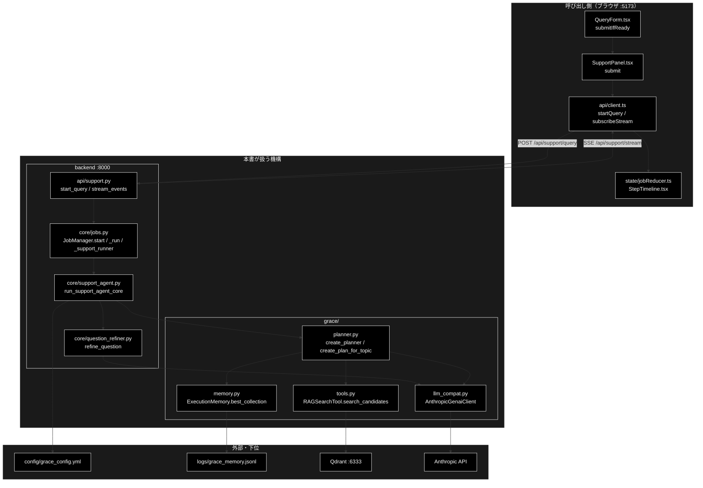
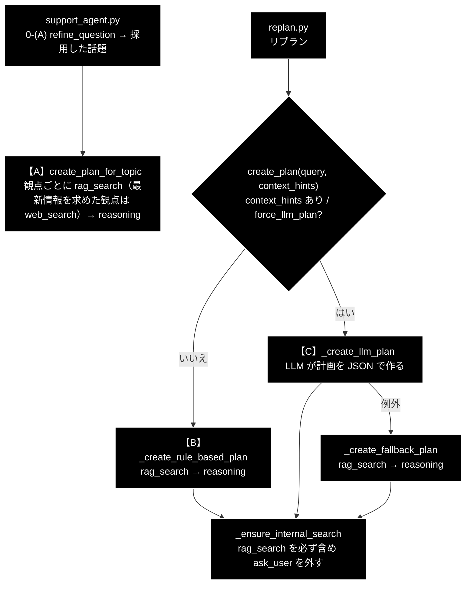
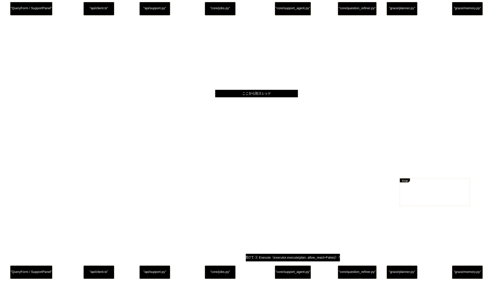

# start_planner.md - 画面の入力から planner が計画を作るまでの呼び出し階層

**Version 1.2** | 最終更新: 2026-10-30

---

## 目次

- [概要](#概要)
  - [主な責務](#主な責務)
  - [各責務対応のモジュール](#各責務対応のモジュール)
  - [アーキテクチャ構成図](#アーキテクチャ構成図)
1. [起動（./run_dev.sh）](#1-起動run_devsh)
2. [呼び出し階層（全体ツリー）](#2-呼び出し階層全体ツリー)
3. [段階ごとの詳細](#3-段階ごとの詳細)
4. [planner の経路](#4-planner-の経路)
5. [シーケンス](#5-シーケンス)
6. [読むときの注意](#6-読むときの注意)
7. [確かめ方](#7-確かめ方)
8. [関連ドキュメント](#8-関連ドキュメント)
9. [変更履歴](#9-変更履歴)

---

## 概要

`./run_dev.sh` で起動した画面（GRACE-Support の「基本版」「GRACE-Support」タブ）に質問を入れてから、
`grace/planner.py` が実行計画（`ExecutionPlan`）を作り、その結果が画面に戻るまでの**モジュール間の呼ぶ・呼ばれる**を、
段階を追って示す。frontend → backend（API・ジョブ・コア）→ grace の 3 領域にまたがる。

各関数の仕様（引数・戻り値）の正本は各領域の `docs/`（[§8](#8-関連ドキュメント)）にあり、本書は書かない。
本書の内容は 2026-10-17 の master（`57050f0`）のコードを追って確かめ、2026-10-30 に 0-(A) 質問の整理（`question_refiner.py`）と観点ごとの計画（`create_plan_for_topic`）に合わせて書き直した。

### 主な責務

- 入力欄の値を送信用のパラメータに組み立て、問い合わせ API を呼ぶ
- 問い合わせをジョブとして受け付け、別スレッドで Support のコアを動かす
- リクエスト単位の設定のコピーを作り、Planner を組み立てる
- 0-(A) で整理した話題から、観点ごとに社内検索する計画を作る（リプランは LLM 計画）
- 実行メモリと Qdrant から、計画に載せるコレクションを決める
- 計画ステップの開始・終了をイベントにして SSE で画面へ返す

### 各責務対応のモジュール

| # | 責務 | 対応モジュール | 説明 |
|---|------|--------------|------|
| 1 | 入力の組み立てと送信 | `frontend/src/components/QueryForm.tsx` | `submitIfReady` が `state/queryParams.ts::buildQueryParams` で組み立て、`SupportPanel.tsx::submit` → `api/client.ts::startQuery` が送る |
| 2 | ジョブの受け付けと起動 | `backend/app/core/jobs.py` | `api/support.py::start_query` から呼ばれ、`JobManager.start` がスレッドを立てて `_support_runner` を動かす |
| 3 | 設定のコピーと Planner の組み立て | `backend/app/core/support_agent.py` | `run_support_agent_core` が `copy.deepcopy(get_config())` を作り、`create_planner(config)` に渡す。0-(A) で `question_refiner.refine_question` が話題・観点に整理する |
| 4 | 計画の生成 | `grace/planner.py` | `Planner.create_plan_for_topic(topic)`（GRACE-Support。LLM なし）。リプランは `create_plan(query, context_hints=...)`（LLM 計画） |
| 5 | コレクションの決定 | `grace/memory.py` | `ExecutionMemory.best_collection` が実績から推定する（観点ごと）。LLM 計画では `grace/tools.py::RAGSearchTool.search_candidates` が一覧を出す |
| 6 | 進捗の配信 | `backend/app/api/support.py` | `stream_events` が `Job.emit` で積まれたイベントを SSE で流し、`frontend/src/state/jobReducer.ts` が反映する |

### アーキテクチャ構成図



**データフロー**:

1. 画面の入力欄の値が `QueryParams`（JSON）になり、`POST /api/support/query` で backend へ渡る。
2. backend は `job_id` をすぐに返し（202）、別スレッドで `run_support_agent_core` を動かす。
3. コアは設定のコピーで Planner を作り、0-(A) で `refine_question(query, config, profile)`（軽量 LLM 1 回）が問い合わせを話題 → 観点に整理する。
4. 採用した話題を `planner.create_plan_for_topic(topic)` に渡す。Planner は観点ごとに実行メモリ（`logs/grace_memory.jsonl`）からコレクションを選び、`ExecutionPlan` を返す（LLM・Qdrant は使わない）。
5. コアは「① Plan」の開始・終了をイベントにし、SSE（`/api/support/stream/{job_id}`）で画面へ流す。

---

## 1. 起動（./run_dev.sh）

| 起動するもの | コマンド（`run_dev.sh` の中） | ポート | 役割 |
|---|---|---|---|
| backend | `uv run uvicorn backend.app.main:app --reload --port 8000` | :8000 | `backend/app/main.py` が `app.include_router(support.router)` で `/api/support/*` を登録する |
| frontend | `cd frontend && npm run dev` | :5173 | Vite。`frontend/vite.config.ts` のプロキシが `/api/*` を :8000 へ中継する（SSE もここを通る） |

> ブラウザで開くのは :5173。:8000 を直接開く必要はない。

---

## 2. 呼び出し階層（全体ツリー）

`──▶` は「次の段階へ」、`└` / `├` は「その中で呼ぶもの」を表す。

```
━━━ [ブラウザ :5173] ━━━━━━━━━━━━━━━━━━━━━━━━━━━━━━━━━━━━━━━━━━━━━━━━━━━━━━
①  QueryForm.tsx::submitIfReady
     ├ 送信の入口は 3 つ: ボタン / 単一行の Enter / 複数行の Ctrl+Enter（state/submitKey.ts::isSubmitKey）
     ├ state/queryParams.ts::buildQueryParams()          入力欄 → QueryParams
     └ props.onSubmit(params)
②  SupportPanel.tsx::submit(params)
     ├ api/client.ts::startQuery()        POST /api/support/query ──┐ Vite プロキシ
     └ api/client.ts::subscribeStream()   GET  /api/support/stream/{job_id}（EventSource）
━━━ [backend :8000] ━━━━━━━━━━━━━━━━━━━━━━━━━━━━━━━━━━━━━━━━━━━━━━━━━━━━━━━━
③  api/support.py::start_query(QueryRequest)
     └ core/jobs.py::JobManager.start(JobParams)
          ├ InterventionBridge を作る（HITL 用）
          └ threading.Thread(target=_run) を起動 → すぐ 202 {job_id, stream_url} を返す
④  （ワーカースレッド）core/jobs.py::JobManager._run(job)
     └ _support_runner(params, emit, confirm)
          └ core/support_agent.py::run_support_agent_core(query, …, emit, confirm)
⑤  run_support_agent_core
     ├ config = copy.deepcopy(get_config())      grace/config.py（yml → 環境変数 → GraceConfig）
     ├ create_tool_registry(config)
     ├ planner = create_planner(config) ─────────────────────▶ ⑥
     ├ create_executor(config, tool_registry)
     ├ 0-(A) core/question_refiner.py::refine_question(query, config, profile)   ← 軽量 LLM 1 回
     │    ├ build_refine_prompt() → client.models.generate_content → anthropic messages.create
     │    ├ parse_refine_output()   形式と書き写しの検査（失敗なら元の文の 1 話題・1 観点）
     │    └ restrict_web_query()    Web 検索の語から問い合わせに無い語を外す
     │   範囲内の話題が 2 つ以上 → resolve_confirm（画面で選ばせる）。query = 採用した話題の answer_question
     ├ 0-(B) config.qdrant.allowed_collections = 業界プロファイルのコレクション
     └ ① step_started("plan")
         plan = planner.create_plan_for_topic(adopted_topic) ─────▶ ⑦
         step_finished("plan", steps=件数, complexity=0.5)
━━━ [grace/] ━━━━━━━━━━━━━━━━━━━━━━━━━━━━━━━━━━━━━━━━━━━━━━━━━━━━━━━━━━━━━━━
⑥  planner.py::create_planner → Planner.__init__
     ├ config.py::resolve_heavy_model(config)
     ├ llm_compat.py::create_chat_client(config) → AnthropicGenaiClient（まだ接続しない）
     ├ memory.py::create_execution_memory("logs/grace_memory.jsonl")
     └ self._rag_tool = None（LLM 計画で必要になったら作る）
⑦  planner.py::Planner.create_plan_for_topic(topic)      【A】GRACE-Support（LLM・Qdrant なし）
     ├ 観点ごとに
     │    ├ _prioritized_collection(aspect.search_query)
     │    │    └ memory.py::ExecutionMemory.best_collection(exclude=_is_excluded)
     │    │         └ collection_priors() → load() / extract_keywords() / _record_keywords()
     │    ├ rag_search（query=search_query・web_query・fallback="web_search"）
     │    └ wants_latest_web なら web_search（query=web_query・required=True）
     └ reasoning（depends_on なし）
   planner.py::Planner.create_plan(query, context_hints=...)  リプラン（replan.py）から
     ├ context_hints あり / force_llm_plan → _create_llm_plan()   【C】LLM 計画
     │    ├ _build_plan_prompt()
     │    │    └ _get_available_collections()
     │    │         └ tools.py::RAGSearchTool(config).search_candidates()
     │    │              ├ _get_all_collections_dynamic()   Qdrant: get_collections / count（キャッシュあり）
     │    │              ├ _apply_allowed_collections()
     │    │              └ _apply_excluded_collections()
     │    ├ _generate_plan_with_retry()                  ← LLM 呼び出し（最大 llm_plan_max_attempts 回）
     │    │    └ ExecutionPlan.model_validate_json()
     │    ├ _finalize_plan() → _stamp_llm_plan() / validate_plan_dependencies() / repair_plan_dependencies()
     │    └ 例外のとき → _create_fallback_plan() → _prioritized_collection() → _build_rag_reasoning_plan()
     ├ それ以外 → _create_rule_based_plan()             【B】rag_search → reasoning（LLM なし）
     └ _ensure_internal_search()                         rag_search を必ず含め、ask_user を外す
━━━ [戻り：画面への通知] ━━━━━━━━━━━━━━━━━━━━━━━━━━━━━━━━━━━━━━━━━━━━━━━━━━━━
⑧  ExecutionPlan → support_agent.py が emit(SupportEvent: step "plan" finished)
     → core/jobs.py::Job.emit()          events に積み、待っている SSE を起こす
     → api/support.py::stream_events の sse()   "data: {...}\n\n"
     → api/client.ts::subscribeStream → SupportPanel の dispatch
     → state/jobReducer.ts（case 'step'）→ StepTimeline.tsx に「① Plan（planner）」が出る
```

---

## 3. 段階ごとの詳細

| 段階 | 層 | 呼ぶ側 → 呼ばれる側 | 渡すもの | 返るもの |
|:--:|---|---|---|---|
| ① | frontend | `QueryForm.tsx::submitIfReady` → `state/queryParams.ts::buildQueryParams` → `onSubmit` | 入力欄の値（質問・業界・モデル・Web 可否・dry-run 等） | `QueryParams` |
| ② | frontend | `SupportPanel.tsx::submit` → `api/client.ts::startQuery` / `subscribeStream` | `QueryParams`（JSON） | `job_id`。以後 SSE でイベントが届く |
| ③ | backend API | `api/support.py::start_query` → `core/jobs.py::JobManager.start` | `JobParams` | 202 `{job_id, stream_url}`（処理の完了を待たない） |
| ④ | backend ジョブ | `JobManager._run` → `_support_runner` → `core/support_agent.py::run_support_agent_core` | 質問・オプション・`emit`・`confirm` | `SupportResult`（このときは計画どころか全工程が終わっている） |
| ⑤ | backend コア | `run_support_agent_core` → `core/question_refiner.py::refine_question` → `grace/planner.py::create_planner` / `Planner.create_plan_for_topic` | 設定のコピー（`GraceConfig`）・問い合わせ → 採用した話題 | `ExecutionPlan` |
| ⑥ | grace | `create_planner` → `Planner.__init__` | 設定 | Planner（LLM クライアント・実行メモリを持つ） |
| ⑦ | grace | `Planner.create_plan_for_topic`（【A】）。リプランは `create_plan` の【B】/【C】（[§4](#4-planner-の経路)） | 話題（観点ごとの検索文・Web 検索語） | `ExecutionPlan` |
| ⑧ | 戻り | `Job.emit` → `stream_events` → `subscribeStream` → `jobReducer` | `SupportEvent`（`type="step"`, `step="plan"`） | 画面の「① Plan」の表示 |

---

## 4. planner の経路

### 4.1 振り分け



> ⚠️ **2026-10-29 までは、文字列で経路を振り分けていた。** `is_ambiguous_query`（「その件」等の指示語）で ask_user だけの計画、
> `estimate_complexity`（「比較」「詳しく」等の加点と長さ）と `_LLM_PLAN_MARKERS`（「最新ニュース」等）で LLM 計画、それ以外はルールベース、
> の 3 経路だった。画面の 3 行（「Jed York CEO が…」「その件の経緯を詳しく」「最新ニュースを検索して…」）は社内検索が一度も呼ばれず、
> どの検索にも同じ質問文を使っていた。いまは 0-(A) の LLM が観点と検索文を決め、planner は文字列で判断しない。

### 4.2 経路の比較

| 経路 | 呼ぶ関数 | LLM | Qdrant | 実行メモリ | できる計画 |
|---|---|:--:|:--:|:--:|---|
| 【A】観点ごと | `create_plan_for_topic` | 呼ばない（0-(A) で 1 回呼んだ後） | 使わない | `best_collection`（観点ごと） | 観点ごとの `rag_search`（`web_query` つき）、最新情報を求めた観点の `web_search`（`required=True`）、最後に `reasoning`（依存なし）。complexity 0.5 |
| 【B】ルールベース | `_create_rule_based_plan` → `_build_rag_reasoning_plan` | 呼ばない | 使わない | `best_collection` | `rag_search`（collection は実績から、無ければ None）→ `reasoning`。complexity 0.5 |
| 【C】LLM 計画 | `_create_llm_plan` | 計画の生成（最大 `llm_plan_max_attempts`＝2 回） | コレクション一覧だけ（`search_candidates`） | 使わない | LLM が決めたステップ。`_stamp_llm_plan` が `plan_id`・`created_at`・各ステップの `timeout_seconds` を上書きする |
| フォールバック | `_create_fallback_plan` | 呼ばない | 使わない | `best_collection` | 【B】と同じ形（complexity 0.5） |

- 【A】【B】とフォールバックの `rag_search` には `fallback="web_search"` が付く。どの経路でも、ステップの `timeout_seconds` は `planner.step_timeout_seconds`（既定 30）になる。
- 【C】の LLM 呼び出しは `grace/llm_compat.py::AnthropicGenaiClient` を通る。`response_schema=ExecutionPlan` は、JSON スキーマのヒントとしてシステム指示に入る（API のネイティブな構造化出力ではない）。
- 【A】の計画は `executor.execute(plan, allow_react=False)` で実行する（観点ごとに決めた検索文を ReAct に決め直させない）。

---

## 5. シーケンス

画面からの【A】の経路。0-(A) で Anthropic API へ 1 回往復する（[§2](#2-呼び出し階層全体ツリー) ⑤）。



---

## 6. 読むときの注意

- **planner は検索をしない。** Qdrant に触れるのは【C】（リプラン）でコレクション一覧を取るときだけ。実際の検索は次の ② Execute で、executor の中の `grace/tools.py::RAGSearchTool.execute` が行う。
- **Planner はリクエストごとに作られる**（`copy.deepcopy(get_config())` のコピーを渡す）。0-(B) で `config.qdrant.allowed_collections` を書き換えるのは Planner を作った後だが、同じ config オブジェクトなので、【C】の `_get_available_collections` からは書き換え後の値が見える。
- **計画の中身は画面へ送られない。** SSE で届くのは「① Plan」のステップ数と complexity だけ。ステップごとの検索語は「① Plan」のログ（`[plan] stepN: rag_search（…）`）と backend のログで見る（[§7](#7-確かめ方)）。
- **planner に渡るのは入力欄の文ではなく、0-(A) が整理した話題である。** 回答用の質問文（`answer_question`）は指示語を解決して書き直したもの、社内検索の文（`search_query`）は観点ごとの 1 文。整理に失敗したときだけ、入力欄の文がそのまま 1 話題・1 観点になる。
- `run_support_agent_core` は全工程（① Plan 〜 ⑥ Action）を 1 本で実行する。④ の `_support_runner` に戻ってくるのは、計画だけでなく全部が終わったとき。

---

## 7. 確かめ方

### 7.1 ログで経路を見分ける

grace のログは `grace/config.py::init_grace_logging` の設定により、`logs/grace_run.log`（と uvicorn を動かしているターミナル）に出る。

| ログの文言（`grace/planner.py`） | 意味 |
|---|---|
| `Plan from refined topic: [...]` | 【A】。`アクション:検索文` の並び |
| `Creating execution plan for: …` | `create_plan` に入った（【B】【C】） |
| `[memory] prioritized collection for query: …` | 実行メモリがコレクションを選んだ（【A】【B】・フォールバック）。出なければ None（全コレクションを検索） |
| `[plan] rag_search が無いので先頭に足しました…` / `[plan] ask_user を外しました…` | `_ensure_internal_search` が【C】の計画を直した |
| `Creating LLM execution plan for: …` → `[GRACE PLANNER IPO: INPUT]` → `Final Execution Plan:` | 【C】。プロンプトと計画の全文が出る |
| `Failed to create plan with LLM: …` → `Falling back to simple plan` | 【C】が失敗してフォールバックした |

### 7.2 planner だけを動かす

画面・backend を通さずに計画だけを確かめるときは `tests/usage/usage_planner.py` を使う。
【A】（手で書いた話題を `create_plan_for_topic` へ）と【B】（`create_plan`）を 1 つずつ動かす。どちらも LLM を呼ばない。
0-(A) の整理まで実際の LLM で確かめるときは `tests/usage/usage_refine_question.py`（`ANTHROPIC_API_KEY` が要る）。

リポジトリ直下で、モジュールとして実行する。

```bash
uv run --no-sync python -m tests.usage.usage_planner
```

```
# 出力（2026-10-30 に実行。ログ行は省いた）:
# [A] create_plan_for_topic -> complexity=0.5
#   step1: rag_search - 社内検索: 経緯（Web 検索語: Jed York GM コーチ 経緯）
#   step2: rag_search - 社内検索: 人事（Web 検索語: 49ers GM ヘッドコーチ 人事）
#   step3: web_search - Web 検索: 人事・必ず実行
#   step4: reasoning - 取得した情報を元に回答を生成
# [B] create_plan -> complexity=0.5
#   step1: rag_search - 関連情報を検索
#   step2: reasoning - 取得した情報を元に回答を生成
```

> `python tests/usage/usage_planner.py` のようにファイルを直接指定すると、`sys.path` の先頭がスクリプトのある
> `tests/usage/` になり、`ModuleNotFoundError: No module named 'grace'` で止まる（2026-10-17 に確認）。
> PyCharm で動くのは、PyCharm がプロジェクトのルートを `sys.path` に足しているためである。

---

## 8. 関連ドキュメント

| 文書 | 何の正本か |
|---|---|
| [`frontend/docs/README_frontend.md`](../../frontend/docs/README_frontend.md) | 画面の構成・コンポーネントと `state/` の索引 |
| [`backend/app/api/docs/README_backend_api.md`](../../backend/app/api/docs/README_backend_api.md) | `/api/support/*` の契約・SSE のワイヤ形式 |
| [`backend/app/core/docs/core_process_flow.md`](../../backend/app/core/docs/core_process_flow.md) | Support パイプライン 1 周（0-(A) 〜 ⑥）とジョブ基盤 |
| [`grace/docs/grace_process_flow.md`](../../grace/docs/grace_process_flow.md) | planner → executor → confidence の処理フロー |
| [`grace/docs/grace_data_flow.md`](../../grace/docs/grace_data_flow.md) | `ExecutionPlan` などのデータの形 |
| [`backend/app/core/docs/question_refiner.md`](../../backend/app/core/docs/question_refiner.md) | 0-(A) `refine_question` の IPO |
| [`grace/docs/planner.md`](../../grace/docs/planner.md) | `Planner` の IPO |
| [`grace/docs/memory.md`](../../grace/docs/memory.md) | `ExecutionMemory` の IPO（優先コレクションの推定） |
| [`grace/docs/tools.md`](../../grace/docs/tools.md) | `RAGSearchTool.search_candidates` の IPO |
| [`helper/docs/README_helper.md`](../../helper/docs/README_helper.md) / [`services/docs/README_services.md`](../../services/docs/README_services.md) | 本書の経路では使わない（planner の LLM 呼び出しは `grace/llm_compat.py`、検索は `grace/tools.py`） |

---

## 9. 変更履歴

| バージョン | 日付 | 変更内容 |
|-----------|------|---------|
| 1.0 | 2026-10-17 | 初版作成。`./run_dev.sh` の画面入力から `Planner.create_plan` が計画を作り、画面へ戻るまでの呼び出し階層を、master `57050f0` のコードを追ってまとめた |
| 1.1 | 2026-10-22 | 曖昧クエリの判定（`is_ambiguous_query`）が「あの件」等の手前に対象があれば曖昧としなくなったのに追随 |
| 1.2 | 2026-10-30 | 0-(A) を `question_refiner.refine_question`（LLM で話題 → 観点に整理）に、① を `create_plan_for_topic`（観点ごとの計画）にしたのに追随して §2・§3・§4・§5・§6・§7 を書き直した（曖昧判定・複雑度の推定・`_LLM_PLAN_MARKERS` による振り分けは削除済み）。`tests/usage/usage_planner.py` を新しい経路に書き換え、実行した出力を §7.2 に載せた |
